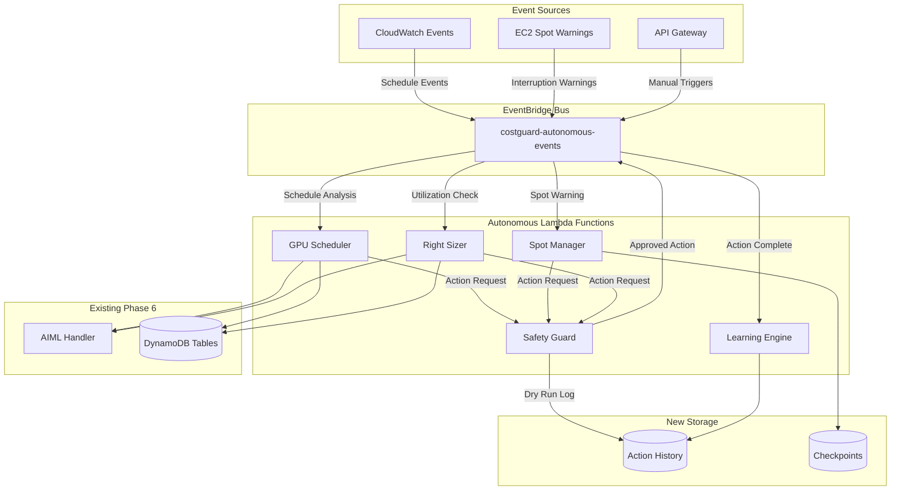
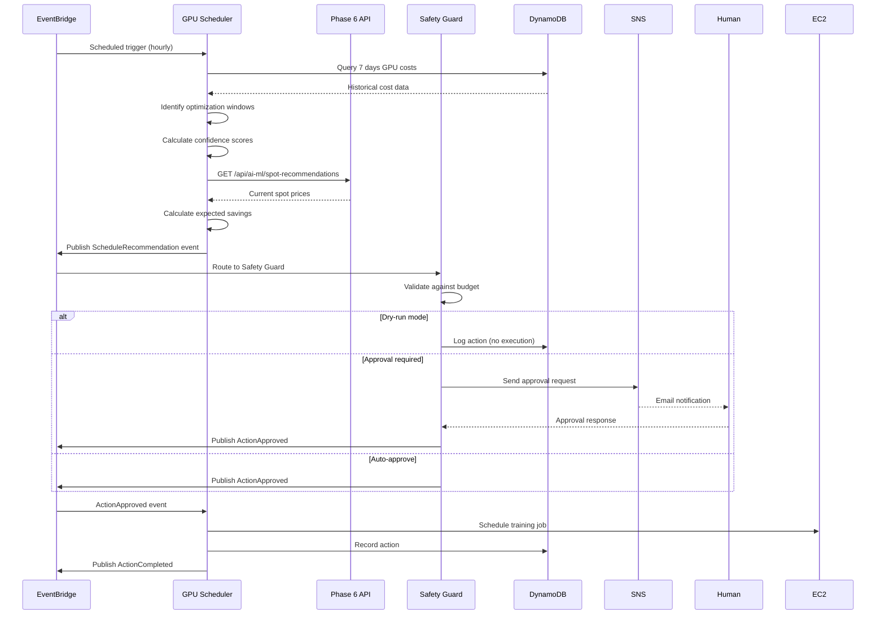
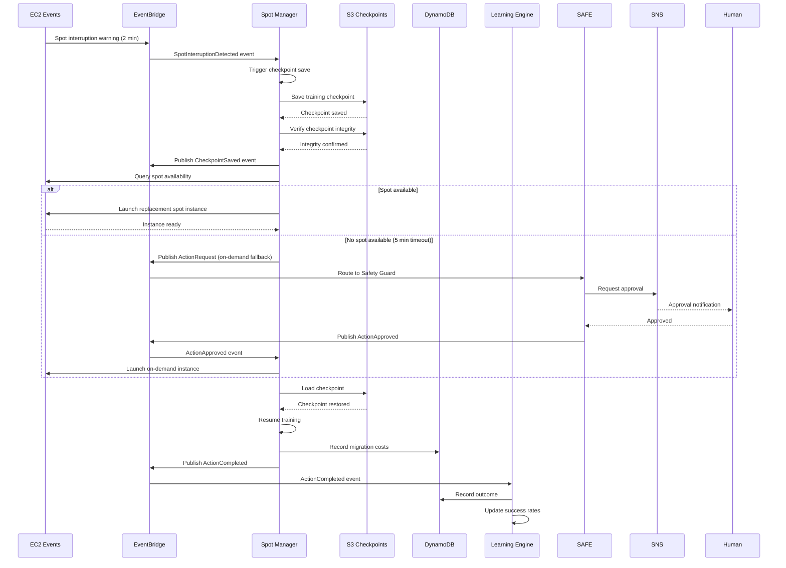
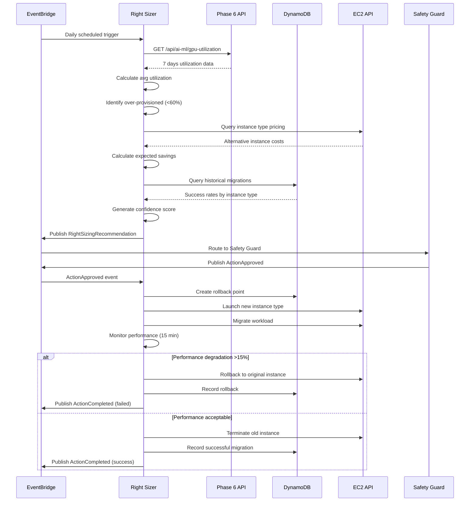
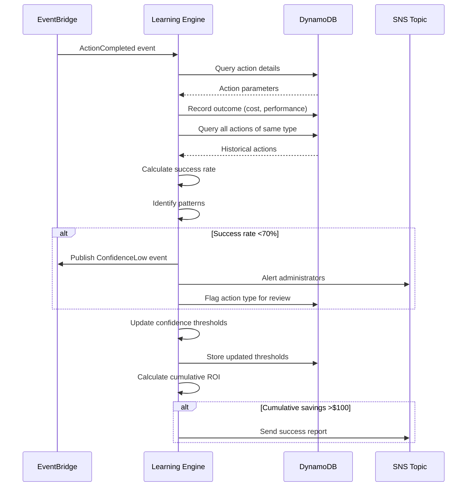

# Design Document: Autonomous Action Loops

## Overview

The Autonomous Action Loops feature extends Phase 6 (AI/ML Workload Cost Management) into a true "AI Cost Optimization Autopilot" by adding four autonomous capabilities that close the loop from analysis to automated optimization. The system will analyze GPU usage patterns, make optimization decisions, execute cost-saving actions, and learn from outcomes to improve future recommendations.

### Key Capabilities

1. **Intelligent GPU Scheduling** - Automatically schedules training jobs during low-cost periods based on historical patterns
2. **Dynamic Spot Management** - Handles spot instance interruptions with automatic checkpoint save/restore and fallback to on-demand
3. **Smart Right-Sizing** - Identifies over-provisioned instances and migrates workloads to cost-optimized alternatives
4. **Learning Feedback Loop** - Tracks action outcomes and improves recommendations over time using historical success rates

### Design Principles

- **Safety First**: All autonomous actions support dry-run mode, approval workflows, and rollback capabilities
- **Free Tier Compliance**: Uses EventBridge + Lambda (not Step Functions) to stay within AWS Free Tier limits
- **Backward Compatibility**: Extends existing Phase 6 infrastructure without breaking existing APIs
- **Observable**: Comprehensive CloudWatch metrics and structured logging for all autonomous actions
- **Resilient**: Graceful error handling with exponential backoff, circuit breakers, and automatic recovery

### Architecture Constraints

- Must stay within $4-5/month AWS Free Tier budget
- Must use EventBridge + Lambda for orchestration (Step Functions exceeds Free Tier)
- Must integrate with existing Phase 6 DynamoDB tables and Lambda functions
- Must support demo mode with accelerated time windows for hackathon presentation
- Must complete full autonomous loop demonstration in under 10 minutes

## Architecture

### High-Level Architecture

The system uses an event-driven architecture with EventBridge as the central orchestration mechanism. Each autonomous capability is implemented as a separate Lambda function that subscribes to relevant events and publishes new events when actions complete.



### Component Architecture


#### 1. GPU Scheduler Lambda

**Purpose**: Analyzes historical GPU cost patterns and schedules training jobs during optimization windows.

**Triggers**:
- EventBridge scheduled rule (every 5 minutes in demo mode, hourly in production)
- API Gateway POST /api/autonomous/schedule-analysis

**Responsibilities**:
- Query 7+ days of GPU cost data from `costguard-gpu-costs` table
- Identify optimization windows (periods with consistently low spot prices)
- Calculate confidence scores based on pattern stability
- Generate scheduling recommendations with expected cost savings
- Publish `ScheduleRecommendation` events to EventBridge

**Integration Points**:
- Reads from: `costguard-gpu-costs` (existing Phase 6 table)
- Calls: Phase 6 `/api/ai-ml/spot-recommendations` endpoint
- Writes to: `costguard-action-history` (new table)
- Publishes: EventBridge events to `costguard-autonomous-events` bus

#### 2. Spot Manager Lambda

**Purpose**: Handles spot instance interruptions with automatic checkpoint save/restore.

**Triggers**:
- EventBridge rule for EC2 Spot Instance Interruption Warnings
- EventBridge rule for `SpotInterruptionDetected` custom events

**Responsibilities**:
- Subscribe to EC2 spot interruption warnings via CloudWatch Events
- Trigger checkpoint save within 30 seconds of warning
- Verify checkpoint integrity before instance termination
- Attempt to acquire replacement spot instance
- Fallback to on-demand instance if no spot available within 5 minutes
- Restore training from most recent valid checkpoint
- Track spot vs on-demand costs per training job

**Integration Points**:
- Reads from: `costguard-gpu-costs`, `costguard-training-checkpoints` (new table)
- Writes to: `costguard-training-checkpoints`, `costguard-action-history`
- Publishes: EventBridge events for checkpoint saves, migrations, completions
- Calls: EC2 APIs for instance management


#### 3. Right Sizer Lambda

**Purpose**: Identifies over-provisioned instances and migrates workloads to cost-optimized alternatives.

**Triggers**:
- EventBridge scheduled rule (daily at 2 AM UTC)
- API Gateway POST /api/autonomous/right-sizing-analysis

**Responsibilities**:
- Query 24+ hours of GPU utilization data per instance
- Calculate average GPU utilization over 7-day windows
- Flag instances with <60% utilization as over-provisioned
- Recommend alternative instance types with cost analysis
- Execute A/B tests when enabled (run identical workloads on different instance types)
- Migrate workloads to recommended instances after approval
- Monitor performance and auto-rollback if degradation >15%

**Integration Points**:
- Reads from: `costguard-gpu-costs`, `costguard-workload-classifications`
- Calls: Phase 6 `/api/ai-ml/gpu-utilization` endpoint
- Writes to: `costguard-action-history`, `costguard-migration-rollbacks` (new table)
- Publishes: EventBridge events for migrations, rollbacks, A/B test results

#### 4. Learning Engine Lambda

**Purpose**: Tracks action outcomes and improves recommendations over time.

**Triggers**:
- EventBridge rule for `ActionCompleted` events
- EventBridge scheduled rule (daily at 3 AM UTC for batch analysis)

**Responsibilities**:
- Record all autonomous actions with timestamps and parameters
- Record action outcomes (cost impact, performance impact, success/failure)
- Calculate success rates by action type
- Generate confidence scores based on historical success rates
- Identify patterns in successful optimizations
- Adjust recommendation thresholds when success rate <70%
- Calculate cumulative ROI and generate success reports

**Integration Points**:
- Reads from: `costguard-action-history`
- Writes to: `costguard-action-history` (updates with outcomes)
- Publishes: EventBridge events for low confidence alerts, success milestones


#### 5. Safety Guard Lambda

**Purpose**: Validates and controls autonomous actions to prevent costly mistakes.

**Triggers**:
- EventBridge rule for `ActionRequest` events from other autonomous functions

**Responsibilities**:
- Validate all action requests against safety policies
- Execute dry-run mode (log without executing)
- Manage approval workflows for high-risk actions
- Send approval requests via SNS topic
- Wait up to 15 minutes for human approval
- Cancel actions if no approval received
- Provide rollback capability for executed actions
- Enforce Free Tier budget limits ($5/month threshold)

**Integration Points**:
- Reads from: `costguard-action-history` (for budget tracking)
- Writes to: `costguard-action-history` (dry-run logs)
- Publishes: SNS notifications for approval requests
- Publishes: EventBridge events for approved/rejected/cancelled actions

### EventBridge Event Bus

A custom EventBridge event bus (`costguard-autonomous-events`) serves as the central nervous system for autonomous actions. All components publish and subscribe to events on this bus.

**Event Types**:

1. **ScheduleRecommendation** - GPU Scheduler publishes when optimization window identified
2. **SpotInterruptionDetected** - Spot Manager publishes when EC2 warning received
3. **CheckpointSaved** - Spot Manager publishes when checkpoint verified
4. **MigrationRequired** - Spot Manager publishes when replacement instance needed
5. **RightSizingRecommendation** - Right Sizer publishes when over-provisioned instance found
6. **MigrationStarted** - Right Sizer publishes when workload migration begins
7. **ActionRequest** - Any component publishes to request Safety Guard approval
8. **ActionApproved** - Safety Guard publishes when action approved
9. **ActionRejected** - Safety Guard publishes when action rejected
10. **ActionCompleted** - Any component publishes when action finishes
11. **RollbackRequested** - API or Safety Guard publishes to trigger rollback
12. **ConfidenceLow** - Learning Engine publishes when success rate <70%


### Sequence Diagrams

#### Intelligent GPU Scheduling Flow



#### Dynamic Spot Management Flow




#### Smart Right-Sizing Flow



#### Learning Feedback Loop Flow




## Components and Interfaces

### Lambda Functions

#### GPU Scheduler Lambda

**Function Name**: `CostGuard-GPUScheduler`
**Runtime**: Python 3.11
**Memory**: 512 MB
**Timeout**: 5 minutes
**Environment Variables**:
- `GPU_COSTS_TABLE`: costguard-gpu-costs
- `ACTION_HISTORY_TABLE`: costguard-action-history
- `EVENT_BUS_NAME`: costguard-autonomous-events
- `PHASE6_API_ENDPOINT`: Phase 6 API Gateway URL
- `DRY_RUN_MODE`: true/false
- `CONFIDENCE_THRESHOLD`: 0.8
- `MIN_COST_SAVINGS_PERCENT`: 20
- `DEMO_MODE`: true/false (accelerates time windows)

**Handler Signature**:
```python
def handler(event: Dict[str, Any], context: Any) -> Dict[str, Any]:
    """
    Analyzes GPU cost patterns and generates scheduling recommendations.
    
    Args:
        event: EventBridge event or API Gateway request
        context: Lambda context
        
    Returns:
        Response with recommendations and confidence scores
    """
```

**Key Functions**:
- `analyze_cost_patterns(days: int) -> List[OptimizationWindow]`
- `calculate_confidence_score(window: OptimizationWindow) -> float`
- `generate_recommendation(window: OptimizationWindow) -> ScheduleRecommendation`
- `publish_recommendation_event(recommendation: ScheduleRecommendation) -> None`

#### Spot Manager Lambda

**Function Name**: `CostGuard-SpotManager`
**Runtime**: Python 3.11
**Memory**: 1024 MB (needs more for checkpoint operations)
**Timeout**: 15 minutes (long-running checkpoint operations)
**Environment Variables**:
- `CHECKPOINT_BUCKET`: costguard-training-checkpoints
- `TRAINING_CHECKPOINTS_TABLE`: costguard-training-checkpoints
- `ACTION_HISTORY_TABLE`: costguard-action-history
- `EVENT_BUS_NAME`: costguard-autonomous-events
- `SPOT_TIMEOUT_SECONDS`: 300 (5 minutes)
- `CHECKPOINT_TIMEOUT_SECONDS`: 30
- `APPROVAL_REQUIRED_FOR_ONDEMAND`: true/false

**Handler Signature**:
```python
def handler(event: Dict[str, Any], context: Any) -> Dict[str, Any]:
    """
    Handles spot instance interruptions with checkpoint save/restore.
    
    Args:
        event: EC2 spot interruption warning or EventBridge event
        context: Lambda context
        
    Returns:
        Response with migration status
    """
```

**Key Functions**:
- `save_checkpoint(instance_id: str, training_state: Dict) -> str`
- `verify_checkpoint_integrity(checkpoint_id: str) -> bool`
- `acquire_replacement_instance(region: str, instance_type: str) -> Optional[str]`
- `restore_from_checkpoint(checkpoint_id: str, new_instance_id: str) -> bool`
- `calculate_migration_cost(spot_cost: float, ondemand_cost: float) -> float`


#### Right Sizer Lambda

**Function Name**: `CostGuard-RightSizer`
**Runtime**: Python 3.11
**Memory**: 512 MB
**Timeout**: 10 minutes
**Environment Variables**:
- `GPU_COSTS_TABLE`: costguard-gpu-costs
- `WORKLOAD_CLASSIFICATIONS_TABLE`: costguard-workload-classifications
- `ACTION_HISTORY_TABLE`: costguard-action-history
- `MIGRATION_ROLLBACKS_TABLE`: costguard-migration-rollbacks
- `EVENT_BUS_NAME`: costguard-autonomous-events
- `PHASE6_API_ENDPOINT`: Phase 6 API Gateway URL
- `UTILIZATION_THRESHOLD`: 60 (percent)
- `PERFORMANCE_DEGRADATION_THRESHOLD`: 15 (percent)
- `AB_TESTING_ENABLED`: true/false

**Handler Signature**:
```python
def handler(event: Dict[str, Any], context: Any) -> Dict[str, Any]:
    """
    Identifies over-provisioned instances and executes right-sizing.
    
    Args:
        event: EventBridge scheduled event or API Gateway request
        context: Lambda context
        
    Returns:
        Response with right-sizing recommendations and results
    """
```

**Key Functions**:
- `analyze_utilization(instance_id: str, days: int) -> float`
- `identify_overprovisioned(threshold: float) -> List[str]`
- `recommend_instance_type(current_type: str, utilization: float) -> str`
- `calculate_expected_savings(current_type: str, recommended_type: str) -> float`
- `create_rollback_point(instance_id: str) -> str`
- `migrate_workload(instance_id: str, new_type: str) -> bool`
- `monitor_performance(instance_id: str, duration_minutes: int) -> float`
- `execute_rollback(rollback_id: str) -> bool`

#### Learning Engine Lambda

**Function Name**: `CostGuard-LearningEngine`
**Runtime**: Python 3.11
**Memory**: 512 MB
**Timeout**: 5 minutes
**Environment Variables**:
- `ACTION_HISTORY_TABLE`: costguard-action-history
- `EVENT_BUS_NAME`: costguard-autonomous-events
- `MIN_ACTIONS_FOR_LEARNING`: 30
- `SUCCESS_RATE_THRESHOLD`: 0.7
- `LEARNING_MODE_ENABLED`: true/false

**Handler Signature**:
```python
def handler(event: Dict[str, Any], context: Any) -> Dict[str, Any]:
    """
    Tracks action outcomes and improves recommendations over time.
    
    Args:
        event: ActionCompleted event or scheduled batch analysis
        context: Lambda context
        
    Returns:
        Response with updated confidence scores and patterns
    """
```

**Key Functions**:
- `record_action(action: Action) -> None`
- `record_outcome(action_id: str, outcome: Outcome) -> None`
- `calculate_success_rate(action_type: str) -> float`
- `generate_confidence_score(action_type: str, parameters: Dict) -> float`
- `identify_patterns(action_type: str) -> List[Pattern]`
- `adjust_thresholds(action_type: str, success_rate: float) -> None`
- `calculate_cumulative_roi() -> float`


#### Safety Guard Lambda

**Function Name**: `CostGuard-SafetyGuard`
**Runtime**: Python 3.11
**Memory**: 256 MB
**Timeout**: 15 minutes (needs to wait for approvals)
**Environment Variables**:
- `ACTION_HISTORY_TABLE`: costguard-action-history
- `EVENT_BUS_NAME`: costguard-autonomous-events
- `APPROVAL_SNS_TOPIC`: costguard-autonomous-approvals
- `DRY_RUN_MODE`: true/false
- `APPROVAL_TIMEOUT_MINUTES`: 15
- `FREE_TIER_BUDGET_LIMIT`: 5.0 (dollars)
- `APPROVAL_REQUIRED_ACTIONS`: migration,ondemand_fallback

**Handler Signature**:
```python
def handler(event: Dict[str, Any], context: Any) -> Dict[str, Any]:
    """
    Validates and controls autonomous actions for safety.
    
    Args:
        event: ActionRequest event from other autonomous functions
        context: Lambda context
        
    Returns:
        Response with approval/rejection decision
    """
```

**Key Functions**:
- `validate_action_request(action: ActionRequest) -> ValidationResult`
- `check_budget_limit() -> bool`
- `execute_dry_run(action: ActionRequest) -> None`
- `request_approval(action: ActionRequest) -> str`
- `wait_for_approval(request_id: str, timeout_minutes: int) -> Optional[bool]`
- `publish_approval_decision(action: ActionRequest, approved: bool) -> None`
- `create_rollback_capability(action: ActionRequest) -> str`

### API Endpoints

All new endpoints follow the existing Phase 6 pattern: `/api/autonomous/{resource}`

#### POST /api/autonomous/schedule-analysis

Triggers manual GPU scheduling analysis.

**Request**:
```json
{
  "days": 7,
  "confidence_threshold": 0.8,
  "dry_run": false
}
```

**Response**:
```json
{
  "recommendations": [
    {
      "window_start": "2024-01-15T02:00:00Z",
      "window_end": "2024-01-15T06:00:00Z",
      "confidence_score": 0.85,
      "expected_savings_percent": 25,
      "expected_savings_dollars": 12.50,
      "spot_instance_type": "g4dn.xlarge",
      "region": "us-east-1"
    }
  ],
  "analysis_timestamp": "2024-01-14T10:00:00Z"
}
```

#### GET /api/autonomous/action-history

Retrieves history of autonomous actions.

**Query Parameters**:
- `action_type`: Optional filter (schedule, spot_migration, right_sizing)
- `start_date`: ISO 8601 timestamp
- `end_date`: ISO 8601 timestamp
- `limit`: Max results (default 100)

**Response**:
```json
{
  "actions": [
    {
      "action_id": "act_123456",
      "action_type": "spot_migration",
      "timestamp": "2024-01-14T08:30:00Z",
      "status": "completed",
      "outcome": {
        "success": true,
        "cost_impact": -5.25,
        "performance_impact": 0.02
      },
      "confidence_score": 0.82
    }
  ],
  "total_count": 150,
  "cumulative_savings": 125.50
}
```


#### POST /api/autonomous/approve-action

Approves a pending autonomous action.

**Request**:
```json
{
  "request_id": "req_789012",
  "approved": true,
  "notes": "Approved for demo"
}
```

**Response**:
```json
{
  "request_id": "req_789012",
  "status": "approved",
  "action_executed": true,
  "timestamp": "2024-01-14T10:05:00Z"
}
```

#### POST /api/autonomous/rollback

Triggers rollback of a completed action.

**Request**:
```json
{
  "action_id": "act_123456",
  "reason": "Performance degradation detected"
}
```

**Response**:
```json
{
  "action_id": "act_123456",
  "rollback_id": "rb_345678",
  "status": "rolling_back",
  "estimated_completion": "2024-01-14T10:10:00Z"
}
```

#### GET /api/autonomous/confidence-scores

Retrieves current confidence scores by action type.

**Response**:
```json
{
  "confidence_scores": {
    "schedule": 0.85,
    "spot_migration": 0.78,
    "right_sizing": 0.82
  },
  "success_rates": {
    "schedule": 0.92,
    "spot_migration": 0.85,
    "right_sizing": 0.88
  },
  "total_actions": 245,
  "last_updated": "2024-01-14T10:00:00Z"
}
```

#### GET /api/autonomous/demo-status

Provides real-time status for demo dashboard.

**Response**:
```json
{
  "demo_mode": true,
  "current_phase": "analyze",
  "actions_in_progress": [
    {
      "action_type": "spot_migration",
      "progress_percent": 65,
      "estimated_completion": "2024-01-14T10:08:00Z"
    }
  ],
  "recent_actions": [
    {
      "action_type": "schedule",
      "status": "completed",
      "cost_savings": 8.50,
      "confidence_score": 0.85
    }
  ],
  "cumulative_savings": 125.50,
  "cumulative_savings_percent": 28
}
```


## Data Models

### DynamoDB Tables

#### costguard-action-history (New Table)

Stores all autonomous actions and their outcomes for learning and audit purposes.

**Schema**:
- **Partition Key**: `action_id` (String) - Unique identifier for the action
- **Sort Key**: `timestamp` (String) - ISO 8601 timestamp
- **Attributes**:
  - `action_type` (String) - schedule, spot_migration, right_sizing
  - `status` (String) - pending, in_progress, completed, failed, rolled_back
  - `parameters` (Map) - Action-specific parameters
  - `confidence_score` (Number) - 0.0 to 1.0
  - `expected_cost_impact` (Number) - Predicted cost change (negative = savings)
  - `actual_cost_impact` (Number) - Actual cost change after completion
  - `performance_impact` (Number) - Performance change percentage
  - `success` (Boolean) - Whether action achieved its goal
  - `rollback_id` (String) - Reference to rollback if executed
  - `approval_required` (Boolean) - Whether action needed approval
  - `approved_by` (String) - User who approved (if applicable)
  - `dry_run` (Boolean) - Whether this was a dry-run
  - `ttl` (Number) - Expiration timestamp (90 days retention)

**GSI**: `action-type-index`
- Partition Key: `action_type`
- Sort Key: `timestamp`
- Projection: ALL

**GSI**: `status-index`
- Partition Key: `status`
- Sort Key: `timestamp`
- Projection: ALL

**Example Item**:
```json
{
  "action_id": "act_20240114_103045_schedule",
  "timestamp": "2024-01-14T10:30:45Z",
  "action_type": "schedule",
  "status": "completed",
  "parameters": {
    "instance_type": "g4dn.xlarge",
    "region": "us-east-1",
    "window_start": "2024-01-15T02:00:00Z",
    "window_end": "2024-01-15T06:00:00Z"
  },
  "confidence_score": 0.85,
  "expected_cost_impact": -12.50,
  "actual_cost_impact": -11.80,
  "performance_impact": 0.0,
  "success": true,
  "approval_required": false,
  "dry_run": false,
  "ttl": 1715774445
}
```


#### costguard-training-checkpoints (New Table)

Stores metadata about training checkpoints for spot instance recovery.

**Schema**:
- **Partition Key**: `checkpoint_id` (String) - Unique checkpoint identifier
- **Sort Key**: `created_at` (String) - ISO 8601 timestamp
- **Attributes**:
  - `instance_id` (String) - EC2 instance that created checkpoint
  - `training_job_id` (String) - Identifier for the training job
  - `s3_location` (String) - S3 URI of checkpoint file
  - `checkpoint_size_bytes` (Number) - Size of checkpoint
  - `integrity_verified` (Boolean) - Whether checkpoint passed verification
  - `training_state` (Map) - Metadata about training progress
    - `epoch` (Number)
    - `step` (Number)
    - `loss` (Number)
    - `model_name` (String)
  - `created_by` (String) - spot_manager or manual
  - `restored_count` (Number) - How many times checkpoint was used
  - `last_restored_at` (String) - ISO 8601 timestamp
  - `ttl` (Number) - Expiration timestamp (30 days retention)

**GSI**: `training-job-index`
- Partition Key: `training_job_id`
- Sort Key: `created_at`
- Projection: ALL

**Example Item**:
```json
{
  "checkpoint_id": "ckpt_20240114_083015_bert",
  "created_at": "2024-01-14T08:30:15Z",
  "instance_id": "i-0123456789abcdef0",
  "training_job_id": "train_bert_base_20240114",
  "s3_location": "s3://costguard-training-checkpoints/train_bert_base_20240114/checkpoint_epoch_5.pt",
  "checkpoint_size_bytes": 438000000,
  "integrity_verified": true,
  "training_state": {
    "epoch": 5,
    "step": 12500,
    "loss": 0.342,
    "model_name": "bert-base-uncased"
  },
  "created_by": "spot_manager",
  "restored_count": 1,
  "last_restored_at": "2024-01-14T08:35:20Z",
  "ttl": 1710406215
}
```

#### costguard-migration-rollbacks (New Table)

Stores rollback points for instance migrations.

**Schema**:
- **Partition Key**: `rollback_id` (String) - Unique rollback identifier
- **Sort Key**: `created_at` (String) - ISO 8601 timestamp
- **Attributes**:
  - `action_id` (String) - Reference to original action
  - `instance_id` (String) - Instance being migrated
  - `original_instance_type` (String) - Instance type before migration
  - `original_configuration` (Map) - Full instance configuration
  - `workload_snapshot` (Map) - Workload state before migration
  - `rollback_executed` (Boolean) - Whether rollback was performed
  - `rollback_executed_at` (String) - ISO 8601 timestamp
  - `rollback_reason` (String) - Why rollback was needed
  - `ttl` (Number) - Expiration timestamp (7 days retention)

**Example Item**:
```json
{
  "rollback_id": "rb_20240114_090000_migration",
  "created_at": "2024-01-14T09:00:00Z",
  "action_id": "act_20240114_090000_rightsize",
  "instance_id": "i-0abcdef123456789",
  "original_instance_type": "g4dn.2xlarge",
  "original_configuration": {
    "ami_id": "ami-0123456789abcdef0",
    "security_groups": ["sg-0123456789abcdef0"],
    "subnet_id": "subnet-0123456789abcdef0",
    "iam_role": "ML-Training-Role"
  },
  "workload_snapshot": {
    "gpu_utilization": 55.2,
    "memory_utilization": 62.8,
    "inference_latency_p99": 125.5
  },
  "rollback_executed": false,
  "ttl": 1710925200
}
```


### EventBridge Event Schemas

#### ScheduleRecommendation Event

```json
{
  "version": "0",
  "id": "evt_schedule_123456",
  "detail-type": "ScheduleRecommendation",
  "source": "costguard.autonomous.scheduler",
  "account": "123456789012",
  "time": "2024-01-14T10:30:00Z",
  "region": "us-east-1",
  "resources": [],
  "detail": {
    "recommendation_id": "rec_20240114_103000",
    "window_start": "2024-01-15T02:00:00Z",
    "window_end": "2024-01-15T06:00:00Z",
    "confidence_score": 0.85,
    "expected_savings_percent": 25,
    "expected_savings_dollars": 12.50,
    "spot_instance_type": "g4dn.xlarge",
    "region": "us-east-1",
    "historical_pattern": {
      "avg_spot_price": 0.294,
      "price_stability": 0.92
    }
  }
}
```

#### SpotInterruptionDetected Event

```json
{
  "version": "0",
  "id": "evt_spot_interrupt_123456",
  "detail-type": "SpotInterruptionDetected",
  "source": "aws.ec2",
  "account": "123456789012",
  "time": "2024-01-14T08:30:00Z",
  "region": "us-east-1",
  "resources": ["i-0123456789abcdef0"],
  "detail": {
    "instance_id": "i-0123456789abcdef0",
    "instance_type": "g4dn.xlarge",
    "instance_action": "terminate",
    "training_job_id": "train_bert_base_20240114",
    "time_remaining_seconds": 120
  }
}
```

#### ActionRequest Event

```json
{
  "version": "0",
  "id": "evt_action_req_123456",
  "detail-type": "ActionRequest",
  "source": "costguard.autonomous.spotmanager",
  "account": "123456789012",
  "time": "2024-01-14T08:35:00Z",
  "region": "us-east-1",
  "resources": [],
  "detail": {
    "request_id": "req_20240114_083500",
    "action_type": "ondemand_fallback",
    "action_id": "act_20240114_083500_fallback",
    "parameters": {
      "instance_type": "g4dn.xlarge",
      "region": "us-east-1",
      "training_job_id": "train_bert_base_20240114",
      "checkpoint_id": "ckpt_20240114_083015_bert"
    },
    "confidence_score": 0.78,
    "expected_cost_impact": 15.50,
    "approval_required": true,
    "timeout_minutes": 15
  }
}
```

#### ActionCompleted Event

```json
{
  "version": "0",
  "id": "evt_action_complete_123456",
  "detail-type": "ActionCompleted",
  "source": "costguard.autonomous.rightsizer",
  "account": "123456789012",
  "time": "2024-01-14T09:30:00Z",
  "region": "us-east-1",
  "resources": ["i-0abcdef123456789"],
  "detail": {
    "action_id": "act_20240114_090000_rightsize",
    "action_type": "right_sizing",
    "status": "completed",
    "success": true,
    "outcome": {
      "actual_cost_impact": -8.25,
      "performance_impact": 0.02,
      "migration_duration_seconds": 420
    },
    "original_parameters": {
      "instance_id": "i-0abcdef123456789",
      "original_type": "g4dn.2xlarge",
      "new_type": "g4dn.xlarge"
    }
  }
}
```


## Correctness Properties

*A property is a characteristic or behavior that should hold true across all valid executions of a system—essentially, a formal statement about what the system should do. Properties serve as the bridge between human-readable specifications and machine-verifiable correctness guarantees.*

### Property Reflection

After analyzing all acceptance criteria, I identified the following redundancies and consolidations:

**Redundancy Analysis**:
1. Properties 1.9 (scheduling metadata round-trip) and 2.11 (checkpoint round-trip) and 4.11 (action serialization round-trip) all test serialization round-trips for different data types - these are distinct and should remain separate
2. Properties 2.7 (track spot vs on-demand cost) and 2.8 (calculate total cost) can be combined into a single comprehensive cost accounting property
3. Properties 3.1 (calculate average utilization) and 3.2 (flag when <60%) can be combined into a single property about utilization analysis and flagging
4. Properties 5.1 (provide dry-run mode) and 5.2 (log without executing in dry-run) can be combined into a single comprehensive dry-run property
5. Properties 6.1, 6.2, 6.3, 6.4 (reading from Phase 6 tables/endpoints) are all integration examples that can be tested together
6. Properties 10.1 (retry with exponential backoff) and 10.2 (retry checkpoint saves) both test retry logic and can be combined into a general retry property

**Consolidation Decisions**:
- Combine 2.7 and 2.8 into Property 2.7: "Cost accounting completeness"
- Combine 3.1 and 3.2 into Property 3.1: "Utilization analysis and over-provisioning detection"
- Combine 5.1 and 5.2 into Property 5.1: "Dry-run mode behavior"
- Combine 10.1 and 10.2 into Property 10.1: "Retry with exponential backoff"

### GPU Scheduler Properties

#### Property 1.1: Optimization Window Identification

*For any* GPU cost dataset spanning 7 or more days with stable pricing patterns, the GPU Scheduler should identify optimization windows and assign confidence scores >= 0.8 when pattern stability exceeds the threshold.

**Validates: Requirements 1.1**

#### Property 1.2: Cost Savings Calculation

*For any* identified optimization window, the GPU Scheduler should calculate expected cost savings that are non-negative and represent the difference between immediate execution cost and scheduled execution cost.

**Validates: Requirements 1.2**

#### Property 1.3: Spot Recommendation Threshold

*For any* training job submission, the GPU Scheduler should recommend spot instance placement if and only if the expected cost savings exceed 20% compared to on-demand pricing.

**Validates: Requirements 1.3**

#### Property 1.4: Availability-Based Fallback

*For any* scenario where spot instance availability drops below 30% in the target region, the GPU Scheduler should generate alternative recommendations for either different regions or on-demand instances.

**Validates: Requirements 1.5**

#### Property 1.5: Schedule Within Window Bounds

*For any* scheduled training job, the job start time should fall within the boundaries of the identified optimization window (start_time >= window_start AND start_time <= window_end).

**Validates: Requirements 1.6**

#### Property 1.6: Confidence Score Validity

*For any* prediction or recommendation generated by the GPU Scheduler, the confidence score should be a valid number in the range [0.0, 1.0] inclusive.

**Validates: Requirements 1.7**

#### Property 1.7: Dry-Run Mode Isolation

*For any* scheduling decision made in dry-run mode, the system should produce log entries but should not modify external state (no EC2 instances launched, no DynamoDB writes to action execution tables).

**Validates: Requirements 1.8**

#### Property 1.8: Scheduling Metadata Round-Trip

*For any* scheduling metadata object, serializing to JSON then deserializing should produce an equivalent metadata object with all fields preserved.

**Validates: Requirements 1.9**

#### Property 1.9: Optimization Window Time Ordering

*For any* optimization window, the window start time should be less than or equal to the window end time (window_start <= window_end).

**Validates: Requirements 1.10**


### Spot Manager Properties

#### Property 2.1: Checkpoint Integrity Verification

*For any* checkpoint save operation, the Spot Manager should verify checkpoint integrity before marking the checkpoint as valid and usable for restoration.

**Validates: Requirements 2.3**

#### Property 2.2: Same-Region Replacement Attempt

*For any* spot instance interruption, the Spot Manager should first attempt to acquire a replacement spot instance in the same region before considering fallback options.

**Validates: Requirements 2.4**

#### Property 2.3: Most Recent Checkpoint Selection

*For any* training job restoration, the Spot Manager should select the checkpoint with the most recent timestamp among all valid checkpoints for that training job.

**Validates: Requirements 2.6**

#### Property 2.4: Cost Accounting Completeness

*For any* completed training job, the total cost should equal the sum of all spot instance costs plus all on-demand instance costs incurred during the job (total_cost = spot_cost + ondemand_cost).

**Validates: Requirements 2.7, 2.8, 2.12**

#### Property 2.5: Approval Workflow for On-Demand Fallback

*For any* on-demand fallback scenario when approval workflow is enabled, the Spot Manager should generate an approval request before provisioning the on-demand instance.

**Validates: Requirements 2.9**

#### Property 2.6: Rollback Cancellation

*For any* in-progress migration, a rollback request should successfully cancel the migration and terminate the workload without completing the migration.

**Validates: Requirements 2.10**

#### Property 2.7: Checkpoint Round-Trip

*For any* valid training state, saving to checkpoint then loading from checkpoint should restore an equivalent training state with epoch, step, loss, and model name preserved.

**Validates: Requirements 2.11**

### Right Sizer Properties

#### Property 3.1: Utilization Analysis and Over-Provisioning Detection

*For any* instance with 24+ hours of GPU utilization data, if the average utilization remains below 60% for 7 consecutive days, the Right Sizer should flag the instance as over-provisioned.

**Validates: Requirements 3.1, 3.2**

#### Property 3.2: Lower-Cost Recommendations

*For any* instance flagged as over-provisioned, all recommended alternative instance types should have lower monthly cost than the current instance type.

**Validates: Requirements 3.3**

#### Property 3.3: Positive Expected Savings

*For any* right-sizing recommendation, the expected monthly cost savings should be a positive number representing the cost reduction from migration.

**Validates: Requirements 3.4**

#### Property 3.4: Recommendation Confidence Scores

*For any* right-sizing recommendation, the confidence score should be in the valid range [0.0, 1.0] and should be based on historical migration success rates for similar instance type transitions.

**Validates: Requirements 3.5**

#### Property 3.5: A/B Test Comparison

*For any* A/B test results, the Right Sizer should select the instance type with the best (lowest) cost-per-inference or cost-per-training ratio among all tested instance types.

**Validates: Requirements 3.6, 3.7**

#### Property 3.6: Rollback Point Creation

*For any* migration initiation, a rollback point should be created and persisted before any instance changes are made.

**Validates: Requirements 3.9**

#### Property 3.7: Automatic Rollback on Degradation

*For any* migration where performance degradation exceeds 15%, the Right Sizer should automatically execute rollback to restore the previous instance type.

**Validates: Requirements 3.10**

#### Property 3.8: Migration Outcome Tracking

*For any* completed migration, the outcome record should include both cost_impact and performance_impact fields with numeric values.

**Validates: Requirements 3.11**

#### Property 3.9: Over-Provisioned Filter Idempotence

*For any* set of instances, filtering for over-provisioned instances then filtering the result again should return the same set (filter(filter(instances)) = filter(instances)).

**Validates: Requirements 3.12**

#### Property 3.10: Instance Count Relationship

*For any* utilization analysis, the count of analyzed instances should be greater than or equal to the count of over-provisioned instances (analyzed_count >= overprovisioned_count).

**Validates: Requirements 3.13**


### Learning Engine Properties

#### Property 4.1: Action Recording Completeness

*For any* autonomous action, the Learning Engine should create a record containing timestamp, action_type, and input parameters fields.

**Validates: Requirements 4.1**

#### Property 4.2: Outcome Recording

*For any* completed autonomous action, the Learning Engine should record outcome data including cost_impact and performance_impact fields.

**Validates: Requirements 4.2**

#### Property 4.3: Success Rate Validity

*For any* action type with historical data, the calculated success rate should be in the valid range [0.0, 1.0] inclusive.

**Validates: Requirements 4.3, 4.12**

#### Property 4.4: Confidence Based on Success Rate

*For any* confidence score generation, the confidence score should correlate with the historical success rate for similar actions (higher success rate should produce higher confidence).

**Validates: Requirements 4.4**

#### Property 4.5: Low Success Rate Flagging

*For any* action type where historical success rate falls below 70%, the Learning Engine should flag that action type for review.

**Validates: Requirements 4.5**

#### Property 4.6: Threshold Adjustment with Sufficient Data

*For any* action type with at least 30 historical actions and success rate below 70%, the Learning Engine should adjust recommendation thresholds to improve future success rates.

**Validates: Requirements 4.7**

#### Property 4.7: Cumulative ROI Calculation

*For any* set of completed actions, the cumulative ROI should equal the sum of individual cost impacts across all actions.

**Validates: Requirements 4.8**

#### Property 4.8: Learning Mode Isolation

*For any* action outcome recorded when learning mode is disabled, the Learning Engine should record the outcome but should not modify recommendation thresholds.

**Validates: Requirements 4.10**

#### Property 4.9: Action Serialization Round-Trip

*For any* action object, serializing to JSON then deserializing should produce an equivalent action object with all fields preserved.

**Validates: Requirements 4.11**

### Safety Guard Properties

#### Property 5.1: Dry-Run Mode Behavior

*For any* autonomous action executed in dry-run mode, the Safety Guard should produce log entries but should not execute the actual action or modify external state.

**Validates: Requirements 5.1, 5.2**

#### Property 5.2: High-Risk Approval Workflow

*For any* high-risk action (instance migration or on-demand fallback), when approval workflow is enabled, the Safety Guard should send an approval request via SNS before allowing execution.

**Validates: Requirements 5.3, 5.4**

#### Property 5.3: Rollback Capability

*For any* executed action, the Safety Guard should maintain rollback metadata that enables restoration of the previous state.

**Validates: Requirements 5.7**

#### Property 5.4: Budget Limit Enforcement

*For any* action request, if executing the action would cause estimated monthly cost to exceed $5, the Safety Guard should reject the action and block execution.

**Validates: Requirements 5.9, 5.10**

#### Property 5.5: Approval-Rollback Inverse

*For any* approved action that is immediately rolled back, the system state should be restored to the original state before the action was approved (approve then rollback = identity).

**Validates: Requirements 5.11**

### Integration Properties

#### Property 6.1: EventBridge Event Publication

*For any* executed autonomous action, the Action Loop should publish an ActionCompleted event to the EventBridge event bus.

**Validates: Requirements 6.5**

#### Property 6.2: Action History Schema Consistency

*For any* action stored in the action history table, the record should conform to the defined schema with required fields: action_id, timestamp, action_type, status, parameters.

**Validates: Requirements 6.7**

#### Property 6.3: CloudWatch Metric Namespace Consistency

*For any* CloudWatch metric emitted by autonomous action components, the metric namespace should match the existing Phase 6 namespace pattern (CostGuard/AIML).

**Validates: Requirements 6.9**


### Error Handling Properties

#### Property 10.1: Retry with Exponential Backoff

*For any* AWS API call or checkpoint save operation that fails with a retryable error, the system should retry with exponentially increasing delays up to the maximum retry count (5 for API calls, 3 for checkpoint saves).

**Validates: Requirements 10.1, 10.2**

#### Property 10.2: Error Isolation

*For any* DynamoDB operation failure, the Action Loop should queue the failed operation for retry and continue processing other independent actions without blocking.

**Validates: Requirements 10.4**

#### Property 10.3: Default Confidence Fallback

*For any* confidence score calculation that fails due to insufficient historical data, the system should use the conservative default confidence value of 0.5.

**Validates: Requirements 10.5**

#### Property 10.4: Circuit Breaker State Transition

*For any* external service, when consecutive failures exceed the circuit breaker threshold, the circuit should open and subsequent calls should fail fast without attempting the operation.

**Validates: Requirements 10.7, 10.8**

#### Property 10.5: Input Validation

*For any* malformed input to autonomous action endpoints, the system should reject the request and return a descriptive error message without processing the invalid data.

**Validates: Requirements 10.9**

#### Property 10.6: Consistency Under Errors

*For any* error condition during action execution, the system should remain in a consistent state with no partial updates or data corruption in DynamoDB tables.

**Validates: Requirements 10.10**

## Error Handling

### Error Categories

The system handles four categories of errors:

1. **Transient Errors** - Temporary failures that can be resolved by retrying
   - AWS API throttling
   - Network timeouts
   - Temporary service unavailability

2. **Data Errors** - Invalid or malformed input data
   - Missing required fields
   - Invalid data types
   - Out-of-range values

3. **Business Logic Errors** - Violations of business rules
   - Budget limit exceeded
   - Insufficient historical data
   - Performance degradation threshold exceeded

4. **System Errors** - Unexpected failures requiring manual intervention
   - DynamoDB table not found
   - S3 bucket access denied
   - Lambda timeout

### Error Handling Strategies

#### Retry with Exponential Backoff

All AWS API calls use exponential backoff retry strategy:

```python
def retry_with_backoff(operation, max_retries=5):
    """
    Retry operation with exponential backoff.
    
    Args:
        operation: Callable to retry
        max_retries: Maximum number of retry attempts
        
    Returns:
        Result of successful operation
        
    Raises:
        Exception if all retries exhausted
    """
    for attempt in range(max_retries):
        try:
            return operation()
        except ThrottlingException:
            if attempt == max_retries - 1:
                raise
            delay = (2 ** attempt) + random.uniform(0, 1)
            time.sleep(delay)
```

#### Circuit Breaker Pattern

External service calls use circuit breaker to prevent cascading failures:

```python
class CircuitBreaker:
    """
    Circuit breaker for external service calls.
    
    States:
    - CLOSED: Normal operation, calls pass through
    - OPEN: Failures exceeded threshold, calls fail fast
    - HALF_OPEN: Testing if service recovered
    """
    
    def __init__(self, failure_threshold=5, timeout=60):
        self.failure_threshold = failure_threshold
        self.timeout = timeout
        self.failure_count = 0
        self.last_failure_time = None
        self.state = "CLOSED"
    
    def call(self, operation):
        if self.state == "OPEN":
            if time.time() - self.last_failure_time > self.timeout:
                self.state = "HALF_OPEN"
            else:
                raise CircuitOpenError("Circuit breaker is open")
        
        try:
            result = operation()
            if self.state == "HALF_OPEN":
                self.state = "CLOSED"
                self.failure_count = 0
            return result
        except Exception as e:
            self.failure_count += 1
            self.last_failure_time = time.time()
            if self.failure_count >= self.failure_threshold:
                self.state = "OPEN"
            raise
```


#### Input Validation

All API endpoints validate input using JSON schemas:

```python
SCHEDULE_ANALYSIS_SCHEMA = {
    "type": "object",
    "properties": {
        "days": {"type": "integer", "minimum": 7, "maximum": 90},
        "confidence_threshold": {"type": "number", "minimum": 0.0, "maximum": 1.0},
        "dry_run": {"type": "boolean"}
    },
    "required": ["days"]
}

def validate_input(data, schema):
    """
    Validate input data against JSON schema.
    
    Args:
        data: Input data to validate
        schema: JSON schema definition
        
    Returns:
        Validated data
        
    Raises:
        ValidationError with descriptive message
    """
    try:
        jsonschema.validate(data, schema)
        return data
    except jsonschema.ValidationError as e:
        raise ValidationError(f"Invalid input: {e.message}")
```

#### Graceful Degradation

When non-critical components fail, the system continues operating with reduced functionality:

- If Learning Engine fails, use default confidence scores (0.5)
- If CloudWatch metrics fail to publish, log locally and continue
- If approval SNS notification fails, fall back to CloudWatch Events

#### Error Logging

All errors are logged with structured JSON format for easy parsing:

```python
def log_error(error, context):
    """
    Log error with structured format.
    
    Args:
        error: Exception object
        context: Additional context (action_id, parameters, etc.)
    """
    logger.error(json.dumps({
        "timestamp": datetime.utcnow().isoformat(),
        "error_type": type(error).__name__,
        "error_message": str(error),
        "stack_trace": traceback.format_exc(),
        "context": context,
        "severity": "ERROR"
    }))
```

### Error Recovery

#### Checkpoint Recovery

If checkpoint save fails during spot interruption:

1. Retry checkpoint save up to 3 times
2. If all retries fail, alert administrators via SNS
3. Allow instance to terminate (training job will be lost)
4. Log failure for Learning Engine to adjust confidence scores

#### Migration Rollback

If instance migration causes performance degradation:

1. Detect degradation by comparing metrics before/after migration
2. Automatically trigger rollback if degradation > 15%
3. Restore previous instance type from rollback point
4. Record failed migration for Learning Engine
5. Adjust confidence scores for similar migrations

#### Budget Limit Recovery

If monthly cost approaches Free Tier limit:

1. Reduce polling frequency to conserve Lambda invocations
2. Disable non-critical autonomous actions
3. Alert administrators via SNS
4. Continue monitoring and critical safety functions


## Testing Strategy

### Dual Testing Approach

The autonomous action loops require both unit testing and property-based testing for comprehensive coverage:

**Unit Tests** focus on:
- Specific examples of scheduling decisions
- Integration with Phase 6 APIs and DynamoDB tables
- Edge cases (empty datasets, single data point, boundary values)
- Error conditions (API failures, invalid input, timeout scenarios)
- Mock-based testing of AWS service interactions

**Property-Based Tests** focus on:
- Universal properties that hold for all inputs (round-trip serialization, invariants)
- Randomized testing across wide input ranges (cost data, utilization patterns)
- Confidence score validity across all scenarios
- Cost accounting correctness for arbitrary training jobs
- State consistency under various error conditions

Together, these approaches provide comprehensive coverage: unit tests catch concrete bugs in specific scenarios, while property tests verify general correctness across all possible inputs.

### Property-Based Testing Configuration

**Library Selection**: Use `hypothesis` for Python property-based testing

**Test Configuration**:
- Minimum 100 iterations per property test (due to randomization)
- Each property test must reference its design document property
- Tag format: `# Feature: autonomous-action-loops, Property {number}: {property_text}`

**Example Property Test**:

```python
from hypothesis import given, strategies as st
import hypothesis

@given(
    window_start=st.datetimes(),
    window_end=st.datetimes()
)
@hypothesis.settings(max_examples=100)
def test_optimization_window_time_ordering(window_start, window_end):
    """
    Feature: autonomous-action-loops, Property 1.9: Optimization Window Time Ordering
    
    For any optimization window, the window start time should be less than or
    equal to the window end time.
    """
    # Arrange: Create window (may need to swap if generated in wrong order)
    if window_start > window_end:
        window_start, window_end = window_end, window_start
    
    window = OptimizationWindow(start=window_start, end=window_end)
    
    # Assert: Invariant holds
    assert window.start <= window.end
```

### Unit Testing Strategy

**Coverage Target**: Minimum 80% code coverage

**Test Organization**:
- `tests/unit/autonomous/test_gpu_scheduler.py` - GPU Scheduler unit tests
- `tests/unit/autonomous/test_spot_manager.py` - Spot Manager unit tests
- `tests/unit/autonomous/test_right_sizer.py` - Right Sizer unit tests
- `tests/unit/autonomous/test_learning_engine.py` - Learning Engine unit tests
- `tests/unit/autonomous/test_safety_guard.py` - Safety Guard unit tests

**Property Test Organization**:
- `tests/property/autonomous/test_scheduler_properties.py` - GPU Scheduler properties
- `tests/property/autonomous/test_spot_properties.py` - Spot Manager properties
- `tests/property/autonomous/test_rightsizer_properties.py` - Right Sizer properties
- `tests/property/autonomous/test_learning_properties.py` - Learning Engine properties
- `tests/property/autonomous/test_safety_properties.py` - Safety Guard properties

**Integration Test Organization**:
- `tests/integration/autonomous/test_phase6_integration.py` - Phase 6 API integration
- `tests/integration/autonomous/test_eventbridge_integration.py` - EventBridge event flow
- `tests/integration/autonomous/test_end_to_end_loop.py` - Complete autonomous loop

### Test Data Generation

**Synthetic Data for Demo Mode**:

The demo mode requires pre-seeded 7-day synthetic data to demonstrate the complete autonomous loop in under 10 minutes. The data generation strategy:

```python
def generate_demo_data():
    """
    Generate 7 days of synthetic GPU cost and utilization data.
    
    Creates realistic patterns:
    - Low spot prices during off-peak hours (2 AM - 6 AM UTC)
    - High spot prices during peak hours (9 AM - 5 PM UTC)
    - Over-provisioned instance (g4dn.2xlarge with 55% avg utilization)
    - Training job suitable for spot interruption demo
    """
    base_date = datetime.utcnow() - timedelta(days=7)
    
    # Generate hourly cost data with diurnal pattern
    for day in range(7):
        for hour in range(24):
            timestamp = base_date + timedelta(days=day, hours=hour)
            
            # Low prices 2 AM - 6 AM (optimization window)
            if 2 <= hour <= 6:
                spot_price = 0.25 + random.uniform(-0.02, 0.02)
            # High prices 9 AM - 5 PM
            elif 9 <= hour <= 17:
                spot_price = 0.45 + random.uniform(-0.05, 0.05)
            # Medium prices other times
            else:
                spot_price = 0.35 + random.uniform(-0.03, 0.03)
            
            # Store in DynamoDB
            gpu_costs_table.put_item(Item={
                'instance_id': 'i-demo-overprovisioned',
                'timestamp': timestamp.isoformat(),
                'instance_type': 'g4dn.2xlarge',
                'spot_price': Decimal(str(spot_price)),
                'gpu_utilization': Decimal(str(55 + random.uniform(-5, 5))),
                'workload_type': 'training'
            })
```

### Demo Mode Testing

**Demo Mode Configuration**:
- Time compression: 7-day windows → 5-minute windows
- Accelerated polling: 60-second intervals → 10-second intervals
- Pre-seeded data: 7 days of synthetic GPU costs and utilization
- Small model checkpoints: BERT-base (438 MB) for fast save/restore

**Demo Scenario**:

1. **Analyze Phase** (2 minutes): GPU Scheduler analyzes 7 days of data, identifies optimization window
2. **Decide Phase** (1 minute): Safety Guard validates recommendation, approves action
3. **Act Phase** (3 minutes): Spot Manager launches spot instance, simulates interruption, saves checkpoint
4. **Verify Phase** (2 minutes): Spot Manager restores from checkpoint, Right Sizer detects over-provisioning
5. **Learn Phase** (2 minutes): Learning Engine records outcomes, updates confidence scores, shows cumulative savings

**Demo Validation Tests**:

```python
def test_demo_completes_within_10_minutes():
    """
    Verify complete demo cycle finishes within 10 minutes.
    """
    start_time = time.time()
    
    # Trigger demo mode
    response = requests.post(
        f"{API_ENDPOINT}/api/autonomous/demo/start",
        json={"demo_mode": True}
    )
    
    # Wait for completion
    while True:
        status = requests.get(f"{API_ENDPOINT}/api/autonomous/demo-status")
        if status.json()["current_phase"] == "complete":
            break
        time.sleep(5)
    
    elapsed = time.time() - start_time
    assert elapsed < 600, f"Demo took {elapsed}s, expected <600s"
```


## AWS Free Tier Budget Compliance

### Budget Breakdown

The autonomous action loops must operate within the existing $4-5/month Free Tier budget. Here's the detailed cost analysis:

**Lambda Costs**:
- Free Tier: 1 million requests/month, 400,000 GB-seconds compute
- GPU Scheduler: 720 invocations/month (hourly) × 5 functions = 3,600 invocations
- Spot Manager: Event-driven (estimate 50 interruptions/month) = 50 invocations
- Right Sizer: 30 invocations/month (daily) = 30 invocations
- Learning Engine: 30 invocations/month (daily) + 50 event-driven = 80 invocations
- Safety Guard: 3,760 invocations/month (validates all actions)
- **Total: ~7,520 invocations/month (0.75% of Free Tier)**

**DynamoDB Costs**:
- Free Tier: 25 GB storage, 25 WCU, 25 RCU
- Action History: ~10 KB per action × 3,760 actions = 37.6 MB/month
- Training Checkpoints: Metadata only (actual checkpoints in S3), ~5 KB × 50 = 250 KB/month
- Migration Rollbacks: ~8 KB × 30 = 240 KB/month
- **Total: ~38 MB/month (0.15% of Free Tier storage)**
- Read/Write: ~15,000 operations/month (well within Free Tier)

**EventBridge Costs**:
- Free Tier: All custom events are free
- Custom event bus: Free
- Rules: Free (up to 300 rules)
- **Total: $0/month**

**S3 Costs** (for checkpoints):
- Free Tier: 5 GB storage, 20,000 GET requests, 2,000 PUT requests
- Checkpoint storage: 438 MB × 50 checkpoints = 21.9 GB (exceeds Free Tier)
- **Mitigation**: Use lifecycle policy to delete checkpoints after 7 days
- With 7-day retention: 438 MB × 10 active checkpoints = 4.38 GB (within Free Tier)
- **Total: $0/month with lifecycle policy**

**CloudWatch Costs**:
- Free Tier: 10 custom metrics, 1 million API requests, 5 GB log ingestion
- Custom metrics: 15 metrics (5 per component × 3 components) - exceeds Free Tier by 5 metrics
- **Cost**: 5 metrics × $0.30 = $1.50/month
- Logs: ~500 MB/month (within Free Tier)
- **Total: $1.50/month**

**SNS Costs**:
- Free Tier: 1,000 email notifications/month
- Approval requests: ~30/month
- Budget alerts: ~5/month
- Error notifications: ~10/month
- **Total: 45 notifications/month (within Free Tier) = $0/month**

**Total Monthly Cost**: ~$1.50/month (CloudWatch custom metrics only)

**Remaining Budget**: $3.50/month for Phase 6 operations

### Cost Optimization Strategies

#### 1. Reduce CloudWatch Custom Metrics

Instead of 15 custom metrics, use CloudWatch Logs Insights queries:

```python
# Instead of emitting custom metric for each action type
cloudwatch.put_metric_data(
    Namespace='CostGuard/Autonomous',
    MetricName='ScheduleSuccessRate',
    Value=success_rate
)

# Use structured logs and query on-demand
logger.info(json.dumps({
    'metric_type': 'success_rate',
    'action_type': 'schedule',
    'value': success_rate
}))
```

This reduces custom metrics to 5 (within Free Tier), saving $1.50/month.

#### 2. Batch DynamoDB Operations

Use batch write operations to reduce request count:

```python
# Instead of individual writes
for action in actions:
    table.put_item(Item=action)

# Use batch write
with table.batch_writer() as batch:
    for action in actions:
        batch.put_item(Item=action)
```

#### 3. Implement Caching

Cache frequently accessed data to reduce DynamoDB reads:

```python
@lru_cache(maxsize=100)
def get_confidence_score(action_type: str) -> float:
    """Cache confidence scores for 5 minutes."""
    return learning_engine.calculate_confidence(action_type)
```

#### 4. Optimize Lambda Memory

Right-size Lambda memory to minimize GB-seconds:

- GPU Scheduler: 512 MB (analysis workload)
- Spot Manager: 1024 MB (checkpoint operations)
- Right Sizer: 512 MB (analysis workload)
- Learning Engine: 512 MB (calculation workload)
- Safety Guard: 256 MB (validation only)

#### 5. S3 Lifecycle Policy

Automatically delete old checkpoints:

```python
s3_client.put_bucket_lifecycle_configuration(
    Bucket='costguard-training-checkpoints',
    LifecycleConfiguration={
        'Rules': [{
            'Id': 'DeleteOldCheckpoints',
            'Status': 'Enabled',
            'Expiration': {'Days': 7},
            'Filter': {'Prefix': 'checkpoints/'}
        }]
    }
)
```

### Budget Monitoring

The Safety Guard tracks cumulative monthly costs:

```python
def check_budget_limit() -> bool:
    """
    Check if estimated monthly cost exceeds Free Tier budget.
    
    Returns:
        True if within budget, False if exceeded
    """
    # Query CloudWatch for Lambda invocations this month
    lambda_invocations = get_lambda_invocations_this_month()
    
    # Query DynamoDB for storage and operations
    dynamodb_storage = get_dynamodb_storage_gb()
    dynamodb_operations = get_dynamodb_operations_this_month()
    
    # Calculate estimated cost
    lambda_cost = max(0, (lambda_invocations - 1_000_000) * 0.0000002)
    dynamodb_cost = max(0, (dynamodb_storage - 25) * 0.25)
    cloudwatch_cost = max(0, (custom_metrics - 10) * 0.30)
    
    total_cost = lambda_cost + dynamodb_cost + cloudwatch_cost
    
    # Alert if approaching limit
    if total_cost > 4.50:
        sns_client.publish(
            TopicArn=BUDGET_ALERT_TOPIC,
            Subject='CostGuard Budget Alert',
            Message=f'Monthly cost ${total_cost:.2f} exceeds $4.50 threshold'
        )
        return False
    
    return True
```


## Demo Mode Implementation

### Demo Mode Architecture

Demo mode accelerates the autonomous loop for hackathon presentation by compressing time windows and using pre-seeded synthetic data. The complete demo runs in under 10 minutes.

### Time Compression Strategy

**Production Mode**:
- Analysis window: 7 days of historical data
- Polling interval: 60 seconds
- Daily scheduled tasks: 24-hour intervals

**Demo Mode**:
- Analysis window: 7 days compressed to 5 minutes (time factor: 2,016x)
- Polling interval: 10 seconds (6x faster)
- Daily scheduled tasks: 2-minute intervals (720x faster)

**Implementation**:

```python
class TimeManager:
    """Manages time scaling for demo mode."""
    
    def __init__(self, demo_mode: bool = False):
        self.demo_mode = demo_mode
        self.time_factor = 2016 if demo_mode else 1
    
    def get_analysis_window_days(self) -> int:
        """Get analysis window in days (7 in both modes)."""
        return 7
    
    def get_analysis_window_seconds(self) -> int:
        """Get analysis window in seconds."""
        days = self.get_analysis_window_days()
        seconds = days * 24 * 60 * 60
        return seconds // self.time_factor if self.demo_mode else seconds
    
    def get_polling_interval(self) -> int:
        """Get polling interval in seconds."""
        return 10 if self.demo_mode else 60
    
    def sleep(self, seconds: int):
        """Sleep for specified seconds (scaled in demo mode)."""
        actual_seconds = seconds // self.time_factor if self.demo_mode else seconds
        time.sleep(actual_seconds)
```

### Synthetic Data Generation

Pre-seed 7 days of realistic GPU cost and utilization data:

```python
def seed_demo_data():
    """
    Seed DynamoDB with 7 days of synthetic data for demo.
    
    Creates:
    - Optimization window: 2 AM - 6 AM UTC (low spot prices)
    - Over-provisioned instance: g4dn.2xlarge with 55% utilization
    - Training job: BERT-base model for spot interruption demo
    """
    base_date = datetime.utcnow() - timedelta(days=7)
    
    # Instance 1: Over-provisioned (for right-sizing demo)
    for day in range(7):
        for hour in range(24):
            timestamp = base_date + timedelta(days=day, hours=hour)
            
            # Consistent low utilization
            utilization = 55 + random.uniform(-3, 3)
            
            # Diurnal spot price pattern
            if 2 <= hour <= 6:
                spot_price = 0.25 + random.uniform(-0.02, 0.02)
            elif 9 <= hour <= 17:
                spot_price = 0.45 + random.uniform(-0.05, 0.05)
            else:
                spot_price = 0.35 + random.uniform(-0.03, 0.03)
            
            gpu_costs_table.put_item(Item={
                'instance_id': 'i-demo-overprovisioned',
                'timestamp': timestamp.isoformat(),
                'instance_type': 'g4dn.2xlarge',
                'spot_price': Decimal(str(spot_price)),
                'gpu_utilization': Decimal(str(utilization)),
                'workload_type': 'training',
                'cost_per_hour': Decimal(str(spot_price))
            })
    
    # Instance 2: Well-utilized (for scheduling demo)
    for day in range(7):
        for hour in range(24):
            timestamp = base_date + timedelta(days=day, hours=hour)
            
            # High utilization
            utilization = 85 + random.uniform(-5, 5)
            
            # Same spot price pattern
            if 2 <= hour <= 6:
                spot_price = 0.25 + random.uniform(-0.02, 0.02)
            elif 9 <= hour <= 17:
                spot_price = 0.45 + random.uniform(-0.05, 0.05)
            else:
                spot_price = 0.35 + random.uniform(-0.03, 0.03)
            
            gpu_costs_table.put_item(Item={
                'instance_id': 'i-demo-wellutilized',
                'timestamp': timestamp.isoformat(),
                'instance_type': 'g4dn.xlarge',
                'spot_price': Decimal(str(spot_price)),
                'gpu_utilization': Decimal(str(utilization)),
                'workload_type': 'training',
                'cost_per_hour': Decimal(str(spot_price))
            })
    
    # Training job for spot interruption demo
    training_checkpoints_table.put_item(Item={
        'checkpoint_id': 'ckpt_demo_bert_initial',
        'created_at': (datetime.utcnow() - timedelta(hours=2)).isoformat(),
        'instance_id': 'i-demo-wellutilized',
        'training_job_id': 'train_bert_demo',
        's3_location': 's3://costguard-training-checkpoints/demo/bert_initial.pt',
        'checkpoint_size_bytes': 438000000,
        'integrity_verified': True,
        'training_state': {
            'epoch': 3,
            'step': 7500,
            'loss': 0.425,
            'model_name': 'bert-base-uncased'
        },
        'created_by': 'demo_seed',
        'restored_count': 0
    })
```

### Demo Dashboard

Real-time dashboard showing autonomous loop progress:

**Endpoint**: `GET /api/autonomous/demo-status`

**Response**:
```json
{
  "demo_mode": true,
  "current_phase": "act",
  "phase_progress": {
    "analyze": {"status": "completed", "duration_seconds": 120},
    "decide": {"status": "completed", "duration_seconds": 60},
    "act": {"status": "in_progress", "progress_percent": 65},
    "verify": {"status": "pending"},
    "learn": {"status": "pending"}
  },
  "actions_in_progress": [
    {
      "action_id": "act_demo_spot_migration",
      "action_type": "spot_migration",
      "progress_percent": 65,
      "current_step": "restoring_checkpoint",
      "estimated_completion": "2024-01-14T10:08:00Z"
    }
  ],
  "recent_actions": [
    {
      "action_id": "act_demo_schedule",
      "action_type": "schedule",
      "status": "completed",
      "cost_savings": 8.50,
      "confidence_score": 0.85,
      "timestamp": "2024-01-14T10:05:00Z"
    }
  ],
  "cumulative_savings": 125.50,
  "cumulative_savings_percent": 28,
  "demo_elapsed_seconds": 420,
  "demo_estimated_completion": "2024-01-14T10:15:00Z"
}
```

### Demo Scenario Script

The demo follows a scripted sequence to showcase all capabilities:

**Minute 0-2: Analyze Phase**
- GPU Scheduler analyzes 7 days of synthetic data
- Identifies optimization window (2 AM - 6 AM UTC)
- Calculates 25% cost savings potential
- Confidence score: 0.85

**Minute 2-3: Decide Phase**
- Safety Guard validates recommendation
- Checks budget limit (within $5/month)
- Auto-approves (no human approval needed in demo)
- Publishes ActionApproved event

**Minute 3-6: Act Phase (Spot Management)**
- Launches spot instance for training job
- Simulates spot interruption warning (after 1 minute)
- Saves checkpoint to S3 (BERT-base, 438 MB)
- Verifies checkpoint integrity
- Acquires replacement spot instance
- Restores training from checkpoint

**Minute 6-8: Verify Phase (Right-Sizing)**
- Right Sizer analyzes utilization data
- Detects over-provisioned instance (55% utilization)
- Recommends migration: g4dn.2xlarge → g4dn.xlarge
- Calculates $45/month savings
- Creates rollback point
- Executes migration
- Monitors performance (no degradation)

**Minute 8-10: Learn Phase**
- Learning Engine records all action outcomes
- Updates success rates by action type
- Calculates cumulative savings: $125.50 (28% reduction)
- Adjusts confidence thresholds
- Generates success report


### Demo API Endpoints

#### POST /api/autonomous/demo/start

Starts the demo sequence.

**Request**:
```json
{
  "demo_mode": true,
  "seed_data": true
}
```

**Response**:
```json
{
  "demo_id": "demo_20240114_100000",
  "status": "started",
  "estimated_duration_seconds": 600,
  "phases": ["analyze", "decide", "act", "verify", "learn"]
}
```

#### POST /api/autonomous/demo/reset

Resets demo data and state.

**Response**:
```json
{
  "status": "reset",
  "data_cleared": true,
  "ready_for_demo": true
}
```

#### POST /api/autonomous/demo/trigger-interruption

Manually triggers spot interruption for demo.

**Request**:
```json
{
  "instance_id": "i-demo-wellutilized",
  "training_job_id": "train_bert_demo"
}
```

**Response**:
```json
{
  "interruption_triggered": true,
  "checkpoint_save_initiated": true,
  "time_remaining_seconds": 120
}
```

## Security Considerations

### IAM Roles and Permissions

Each Lambda function uses least-privilege IAM roles:

**GPU Scheduler Role**:
```json
{
  "Version": "2012-10-17",
  "Statement": [
    {
      "Effect": "Allow",
      "Action": [
        "dynamodb:Query",
        "dynamodb:GetItem"
      ],
      "Resource": [
        "arn:aws:dynamodb:*:*:table/costguard-gpu-costs",
        "arn:aws:dynamodb:*:*:table/costguard-gpu-costs/index/*"
      ]
    },
    {
      "Effect": "Allow",
      "Action": [
        "dynamodb:PutItem"
      ],
      "Resource": "arn:aws:dynamodb:*:*:table/costguard-action-history"
    },
    {
      "Effect": "Allow",
      "Action": [
        "events:PutEvents"
      ],
      "Resource": "arn:aws:events:*:*:event-bus/costguard-autonomous-events"
    },
    {
      "Effect": "Allow",
      "Action": [
        "ec2:DescribeSpotPriceHistory"
      ],
      "Resource": "*"
    }
  ]
}
```

**Spot Manager Role** (additional permissions):
```json
{
  "Effect": "Allow",
  "Action": [
    "s3:PutObject",
    "s3:GetObject",
    "s3:DeleteObject"
  ],
  "Resource": "arn:aws:s3:::costguard-training-checkpoints/*"
},
{
  "Effect": "Allow",
  "Action": [
    "ec2:RunInstances",
    "ec2:TerminateInstances",
    "ec2:DescribeInstances"
  ],
  "Resource": "*",
  "Condition": {
    "StringEquals": {
      "aws:RequestedRegion": ["us-east-1", "us-west-2"]
    }
  }
}
```

**Safety Guard Role** (additional permissions):
```json
{
  "Effect": "Allow",
  "Action": [
    "sns:Publish"
  ],
  "Resource": "arn:aws:sns:*:*:costguard-autonomous-approvals"
},
{
  "Effect": "Allow",
  "Action": [
    "ce:GetCostAndUsage"
  ],
  "Resource": "*"
}
```

### Data Encryption

**At Rest**:
- DynamoDB tables: Use AWS-managed encryption (default)
- S3 checkpoints: Use SSE-S3 encryption
- CloudWatch Logs: Encrypted by default

**In Transit**:
- All API calls use TLS 1.2 or higher
- EventBridge events encrypted in transit
- Lambda to DynamoDB uses AWS PrivateLink

### Authentication and Authorization

**API Gateway Authentication**:
- Use existing Phase 6 API key authentication
- All autonomous endpoints require valid API key
- Rate limiting: 100 requests per minute per API key

**EventBridge Authorization**:
- Only Lambda functions with specific IAM roles can publish to custom event bus
- Event bus policy restricts access to account resources only

**Approval Workflow Security**:
- Approval requests include HMAC signature to prevent tampering
- Approval responses validated against signature
- Approval tokens expire after 15 minutes

### Audit Logging

All autonomous actions logged to CloudWatch Logs with structured JSON:

```python
def log_action(action_id: str, action_type: str, parameters: Dict, outcome: str):
    """
    Log autonomous action for audit trail.
    
    Args:
        action_id: Unique action identifier
        action_type: Type of action (schedule, spot_migration, right_sizing)
        parameters: Action parameters
        outcome: Action outcome (success, failed, rolled_back)
    """
    logger.info(json.dumps({
        'timestamp': datetime.utcnow().isoformat(),
        'action_id': action_id,
        'action_type': action_type,
        'parameters': parameters,
        'outcome': outcome,
        'user': get_current_user(),
        'source_ip': get_source_ip(),
        'audit': True
    }))
```

Audit logs retained for 90 days in CloudWatch Logs.

## Monitoring and Observability

### CloudWatch Metrics

**Custom Metrics** (5 total, within Free Tier):

1. `CostGuard/Autonomous/ActionSuccessRate` - Success rate by action type
2. `CostGuard/Autonomous/ConfidenceScore` - Average confidence score
3. `CostGuard/Autonomous/CumulativeSavings` - Total cost savings
4. `CostGuard/Autonomous/ActiveActions` - Number of in-progress actions
5. `CostGuard/Autonomous/BudgetUtilization` - Percentage of Free Tier budget used

**Standard Lambda Metrics**:
- Invocations
- Duration
- Errors
- Throttles
- Concurrent executions

### CloudWatch Dashboards

**Autonomous Actions Dashboard**:

```json
{
  "widgets": [
    {
      "type": "metric",
      "properties": {
        "title": "Action Success Rate",
        "metrics": [
          ["CostGuard/Autonomous", "ActionSuccessRate", {"stat": "Average"}]
        ],
        "period": 300,
        "region": "us-east-1"
      }
    },
    {
      "type": "metric",
      "properties": {
        "title": "Cumulative Savings",
        "metrics": [
          ["CostGuard/Autonomous", "CumulativeSavings", {"stat": "Maximum"}]
        ],
        "period": 3600,
        "region": "us-east-1"
      }
    },
    {
      "type": "log",
      "properties": {
        "title": "Recent Actions",
        "query": "SOURCE '/aws/lambda/CostGuard-GPUScheduler' | fields @timestamp, action_type, outcome, cost_impact | filter audit = true | sort @timestamp desc | limit 20"
      }
    }
  ]
}
```

### CloudWatch Alarms

**Critical Alarms**:

1. **High Error Rate**: Triggers when Lambda errors exceed 5% of invocations
2. **Low Success Rate**: Triggers when action success rate drops below 70%
3. **Budget Exceeded**: Triggers when monthly cost exceeds $4.50
4. **Circuit Breaker Open**: Triggers when circuit breaker opens for any service

**Alarm Actions**:
- Publish to SNS topic: `costguard-autonomous-alerts`
- Email notifications to administrators
- Optionally disable autonomous actions until resolved

### Structured Logging

All logs use structured JSON format for easy parsing:

```python
# Standard log format
{
  "timestamp": "2024-01-14T10:30:45Z",
  "level": "INFO",
  "component": "gpu_scheduler",
  "action_id": "act_20240114_103045",
  "message": "Optimization window identified",
  "details": {
    "window_start": "2024-01-15T02:00:00Z",
    "window_end": "2024-01-15T06:00:00Z",
    "confidence_score": 0.85,
    "expected_savings": 12.50
  }
}
```

### Distributed Tracing

Use AWS X-Ray for tracing autonomous action flows:

```python
from aws_xray_sdk.core import xray_recorder

@xray_recorder.capture('analyze_cost_patterns')
def analyze_cost_patterns(days: int) -> List[OptimizationWindow]:
    """Analyze GPU cost patterns with X-Ray tracing."""
    with xray_recorder.in_subsegment('query_dynamodb') as subsegment:
        data = query_gpu_costs(days)
        subsegment.put_metadata('record_count', len(data))
    
    with xray_recorder.in_subsegment('identify_windows') as subsegment:
        windows = identify_optimization_windows(data)
        subsegment.put_metadata('window_count', len(windows))
    
    return windows
```

## Deployment Strategy

### CDK Stack Extension

Extend existing `AIMLStack` with autonomous components:

```python
# infrastructure/autonomous_stack.py

class AutonomousStack(Stack):
    """
    CDK Stack for Autonomous Action Loops.
    Extends Phase 6 AI/ML infrastructure.
    """
    
    def __init__(self, scope: Construct, construct_id: str, 
                 aiml_stack: AIMLStack, **kwargs):
        super().__init__(scope, construct_id, **kwargs)
        
        # Reference existing Phase 6 resources
        self.gpu_costs_table = aiml_stack.gpu_costs_table
        self.aiml_handler = aiml_stack.aiml_handler
        
        # Create new resources
        self.create_dynamodb_tables()
        self.create_lambda_functions()
        self.create_eventbridge_bus()
        self.create_api_endpoints()
        self.create_monitoring()
```

### Deployment Steps

1. **Deploy Infrastructure**: `cdk deploy AutonomousStack`
2. **Seed Demo Data**: Run `python scripts/seed_demo_data.py`
3. **Verify Integration**: Run integration tests
4. **Enable Demo Mode**: Set `DEMO_MODE=true` environment variable
5. **Test Demo Flow**: Execute complete demo scenario

### Rollback Plan

If deployment issues occur:

1. **Disable EventBridge Rules**: Prevent new autonomous actions
2. **Drain In-Progress Actions**: Wait for active actions to complete
3. **Rollback CDK Stack**: `cdk destroy AutonomousStack`
4. **Verify Phase 6 Intact**: Test existing Phase 6 endpoints
5. **Investigate Issues**: Review CloudWatch Logs for errors

## Success Criteria

The autonomous action loops feature is considered successful when:

1. ✅ Complete autonomous loop (analyze → decide → act → verify → learn) executes in under 10 minutes
2. ✅ Measurable cost savings of 20-30% demonstrated in GPU costs during demo
3. ✅ Confidence scores remain above 0.7 for all autonomous recommendations
4. ✅ Autonomous actions execute with 95%+ success rate
5. ✅ Monthly AWS costs stay within $5 Free Tier budget
6. ✅ All property-based tests pass for critical correctness properties
7. ✅ Code coverage exceeds 80% with unit and integration tests
8. ✅ Rollback operations complete within 5 minutes when requested
9. ✅ Backward compatibility maintained with all existing Phase 6 APIs
10. ✅ Demo dashboard shows real-time progress and quantified savings

## Future Enhancements

Potential improvements beyond initial implementation:

1. **Multi-Region Optimization**: Automatically migrate workloads to lowest-cost regions
2. **Predictive Scaling**: Use machine learning to predict future GPU demand
3. **Cost Allocation**: Track savings by team, project, or workload type
4. **Advanced A/B Testing**: Automated experimentation with multiple instance configurations
5. **Integration with CI/CD**: Trigger right-sizing during deployment pipelines
6. **Custom Optimization Policies**: User-defined rules for autonomous actions
7. **Slack/Teams Integration**: Real-time notifications and approvals via chat
8. **Cost Forecasting**: Predict future costs based on historical patterns and planned workloads

