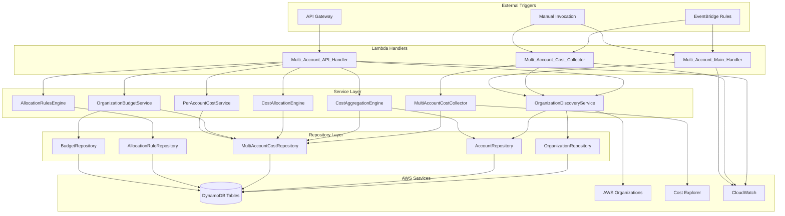
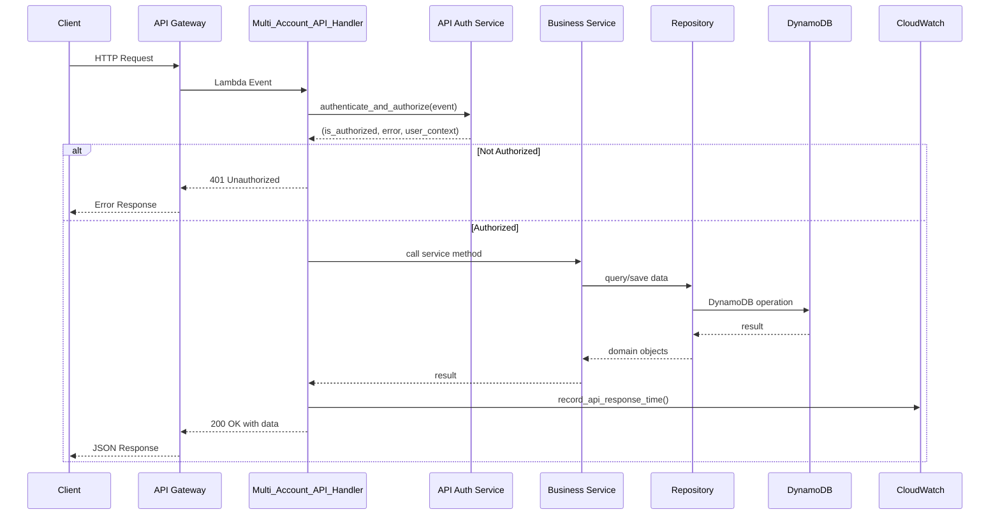
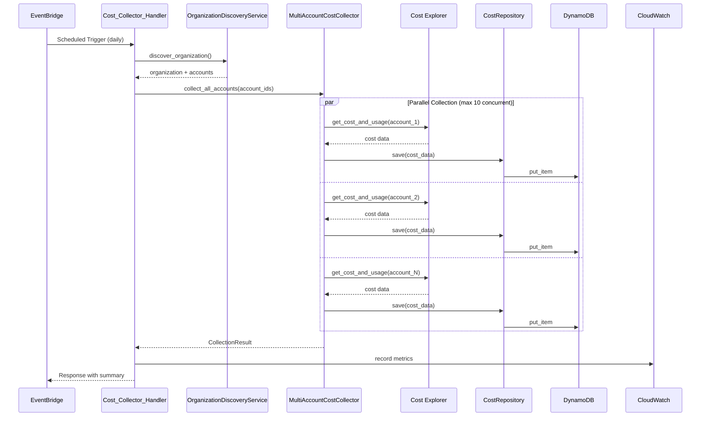

# Design Document: Phase 5 Multi-Account Lambda Handlers

## Overview

This document provides a comprehensive design for three Lambda handler functions that enable multi-account AWS cost management capabilities. The handlers integrate with existing Phase 5 infrastructure to provide organization-wide cost visibility, automated cost collection, and comprehensive cost management operations.

### Purpose

The Phase 5 handlers provide:

1. **Multi_Account_API_Handler**: RESTful API endpoints for querying multi-account cost data, managing budgets, and configuring cost allocation rules
2. **Multi_Account_Cost_Collector**: Scheduled cost collection from all accounts in an AWS Organization with parallel processing
3. **Multi_Account_Main_Handler**: Organization metadata discovery and management operations

### Key Features

- RESTful API with 12+ endpoints for cost management operations
- Automated daily cost collection with parallel processing (max 10 concurrent accounts)
- Organization and account metadata discovery and caching
- Cost aggregation across organization, OU, and account levels
- Tag-based cost allocation with customizable rules
- Hierarchical budget management (organization, OU, account levels)
- Comprehensive error handling with retry logic and exponential backoff
- CloudWatch metrics for operational monitoring
- Standardized response formats with CORS support

### Design Principles

1. **Separation of Concerns**: Clear separation between handlers (API routing), services (business logic), and repositories (data access)
2. **Reusability**: Shared service layer used across all three handlers
3. **Resilience**: Retry logic with exponential backoff for transient failures
4. **Observability**: Comprehensive logging and CloudWatch metrics
5. **Scalability**: Parallel processing with configurable concurrency limits
6. **Consistency**: Standardized error responses and data formats across all endpoints

## Architecture

### System Context



### Handler Responsibilities

#### Multi_Account_API_Handler

**Purpose**: Process API Gateway requests for multi-account cost operations

**Responsibilities**:
- Authenticate and authorize API requests using API key validation
- Route requests to appropriate service handlers based on HTTP method and path
- Validate request parameters (dates, IDs, required fields)
- Transform service responses into standardized API responses
- Record CloudWatch metrics for response times and errors
- Handle CORS headers for cross-origin requests

**Trigger**: API Gateway HTTP requests

**Endpoints**:
- `GET /api/organizations` - List organizations
- `GET /api/organizations/{org_id}/accounts` - List accounts in organization
- `GET /api/costs/consolidated` - Get consolidated costs across all accounts
- `GET /api/costs/by-account` - Get per-account cost breakdowns
- `GET /api/costs/account/{account_id}` - Get costs for specific account
- `GET /api/allocation/by-tag` - Get costs allocated by tag
- `GET /api/allocation/unallocated` - Get unallocated costs
- `POST /api/allocation/rules` - Create cost allocation rule
- `GET /api/budgets/hierarchy` - Get budget hierarchy
- `POST /api/budgets/organization` - Create organization-level budget
- `POST /api/budgets/ou/{ou_id}` - Create OU-level budget

#### Multi_Account_Cost_Collector

**Purpose**: Collect cost data from all accounts in the organization on a scheduled basis

**Responsibilities**:
- Discover all accounts in the organization
- Assume cross-account roles for cost data access
- Query Cost Explorer API for each account's cost data
- Process accounts in parallel (max 10 concurrent)
- Store cost data in DynamoDB
- Retry failed operations with exponential backoff
- Return collection summary with success/failure counts
- Record CloudWatch metrics for collection duration and account counts

**Trigger**: 
- EventBridge scheduled rule (daily at 00:00 UTC)
- Manual invocation with custom parameters

**Configuration**:
- `ORGANIZATION_ID`: AWS Organization ID
- `EXTERNAL_ID`: External ID for cross-account role assumption
- `DAYS_TO_COLLECT`: Number of days of historical data to collect (default: 7)
- `LOG_LEVEL`: Logging level (default: INFO)

#### Multi_Account_Main_Handler

**Purpose**: Discover and manage AWS Organization metadata

**Responsibilities**:
- Call AWS Organizations API to discover organization structure
- Store organization metadata in DynamoDB
- Discover and store all member accounts
- Update existing account metadata
- Mark inactive accounts
- Log discovery metrics

**Trigger**: 
- EventBridge scheduled rule (every 4 hours)
- Manual invocation

### Component Interaction Flow

#### API Request Flow



#### Cost Collection Flow



## Components and Interfaces

### Handler Components

#### 1. Multi_Account_API_Handler

```python
def handler(event: Dict[str, Any], context: Any) -> Dict[str, Any]:
    """
    Main Lambda handler for API Gateway requests.
    
    Args:
        event: API Gateway event containing:
            - httpMethod: HTTP method (GET, POST)
            - path: Request path
            - queryStringParameters: Query parameters
            - body: Request body (JSON string)
            - headers: Request headers
        context: Lambda context
        
    Returns:
        Dict containing:
            - statusCode: HTTP status code (200, 400, 401, 404, 500)
            - headers: Response headers (Content-Type, CORS)
            - body: JSON string response
    """
```

**Endpoint Handlers**:

```python
def handle_list_organizations(event: Dict[str, Any]) -> Dict[str, Any]:
    """List all organizations. Returns organization metadata."""

def handle_list_accounts(event: Dict[str, Any]) -> Dict[str, Any]:
    """List accounts in organization. Extracts org_id from path."""

def handle_consolidated_costs(event: Dict[str, Any]) -> Dict[str, Any]:
    """
    Get consolidated costs across all accounts.
    
    Query Parameters:
        - start_date: YYYY-MM-DD format
        - end_date: YYYY-MM-DD format
        - granularity: MONTHLY, DAILY (default: MONTHLY)
    """

def handle_costs_by_account(event: Dict[str, Any]) -> Dict[str, Any]:
    """Get per-account cost breakdowns."""

def handle_account_costs(event: Dict[str, Any]) -> Dict[str, Any]:
    """Get costs for specific account. Extracts account_id from path."""

def handle_allocation_by_tag(event: Dict[str, Any]) -> Dict[str, Any]:
    """
    Get costs allocated by tag.
    
    Query Parameters:
        - tag_key: Tag key for allocation (default: 'Team')
        - start_date: YYYY-MM-DD format
        - end_date: YYYY-MM-DD format
    """

def handle_unallocated_costs(event: Dict[str, Any]) -> Dict[str, Any]:
    """Get unallocated costs with resource details."""

def handle_create_allocation_rule(event: Dict[str, Any]) -> Dict[str, Any]:
    """
    Create cost allocation rule.
    
    Request Body:
        - rule_name: Rule name (required)
        - rule_type: TAG_BASED, PERCENTAGE, FIXED (required)
        - conditions: JSON object with rule conditions (required)
        - allocation_target: Target for allocation (required)
        - priority: Rule priority (default: 100)
    """

def handle_budget_hierarchy(event: Dict[str, Any]) -> Dict[str, Any]:
    """Get budget hierarchy for organization."""

def handle_create_organization_budget(event: Dict[str, Any]) -> Dict[str, Any]:
    """
    Create organization-level budget.
    
    Request Body:
        - budget_amount: Positive number (required)
        - time_period: MONTHLY, QUARTERLY, ANNUALLY (required)
        - alert_threshold: Percentage threshold for alerts
    """

def handle_create_ou_budget(event: Dict[str, Any]) -> Dict[str, Any]:
    """Create OU-level budget. Extracts ou_id from path."""
```

**Helper Functions**:

```python
def create_error_response(
    status_code: int,
    error_code: str,
    message: str,
    details: Optional[Dict[str, Any]] = None
) -> Dict[str, Any]:
    """Create standardized error response with CORS headers."""

def _get_organization_service() -> OrganizationDiscoveryService:
    """Initialize OrganizationDiscoveryService with repositories."""

def _get_cost_aggregation_engine() -> CostAggregationEngine:
    """Initialize CostAggregationEngine with repositories."""

def _get_per_account_cost_service() -> PerAccountCostService:
    """Initialize PerAccountCostService with repositories."""

def _get_cost_allocation_engine() -> CostAllocationEngine:
    """Initialize CostAllocationEngine with repositories."""

def _get_allocation_rules_engine() -> AllocationRulesEngine:
    """Initialize AllocationRulesEngine with repositories."""

def _get_organization_budget_service() -> OrganizationBudgetService:
    """Initialize OrganizationBudgetService with repositories."""
```

#### 2. Multi_Account_Cost_Collector_Handler

```python
def lambda_handler(event: Dict[str, Any], context: Any) -> Dict[str, Any]:
    """
    Lambda handler for scheduled cost collection.
    
    Triggered by EventBridge daily at 00:00 UTC.
    
    Environment Variables:
        - ORGANIZATION_ID: AWS Organization ID (required)
        - EXTERNAL_ID: External ID for cross-account roles
        - DAYS_TO_COLLECT: Days of historical data (default: 7)
        - LOG_LEVEL: Logging level (default: INFO)
        
    Returns:
        Dict containing:
            - statusCode: 200 (success), 207 (partial), 500 (error)
            - body: JSON with collection summary
    """

def manual_trigger_handler(event: Dict[str, Any], context: Any) -> Dict[str, Any]:
    """
    Handler for manual triggers with custom parameters.
    
    Event Parameters:
        - org_id: Organization ID (optional, uses env var if not provided)
        - account_ids: List of specific account IDs (optional)
        - start_date: Start date YYYY-MM-DD (optional)
        - end_date: End date YYYY-MM-DD (optional)
        - external_id: External ID (optional, uses env var if not provided)
        
    Returns:
        Dict with collection summary
    """
```

#### 3. Multi_Account_Main_Handler

```python
def handler(event: Dict[str, Any], context: Any) -> Dict[str, Any]:
    """
    Lambda handler for multi-account operations.
    
    Event Parameters:
        - operation: Operation to perform (required)
            - 'discover_organization': Discover organization metadata
            - 'collect_costs': Collect cost data
            - 'aggregate_costs': Aggregate costs
            - 'allocate_costs': Allocate costs
        - parameters: Operation-specific parameters
        
    Returns:
        Dict containing:
            - success: Boolean
            - data: Operation result
            - message: Status message
            - timestamp: ISO 8601 timestamp
    """

def handle_discover_organization(parameters: Dict[str, Any]) -> Dict[str, Any]:
    """Discover organization and account metadata."""

def handle_collect_costs(parameters: Dict[str, Any]) -> Dict[str, Any]:
    """
    Collect costs for accounts.
    
    Parameters:
        - account_ids: Optional list of specific accounts
        - start_date: Optional start date
        - end_date: Optional end date
    """

def handle_aggregate_costs(parameters: Dict[str, Any]) -> Dict[str, Any]:
    """
    Aggregate costs.
    
    Parameters:
        - aggregation_type: 'organization', 'ou', 'service'
        - org_id: Organization ID (required)
        - ou_id: OU ID (required for OU aggregation)
        - start_date: Optional start date
        - end_date: Optional end date
    """

def handle_allocate_costs(parameters: Dict[str, Any]) -> Dict[str, Any]:
    """
    Allocate costs.
    
    Parameters:
        - allocation_type: 'by_tags', 'by_rules'
        - org_id: Organization ID (required)
        - start_date: Optional start date
        - end_date: Optional end date
        - tag_key: Tag key for tag-based allocation (default: 'Team')
    """
```

### Service Layer Components

The handlers delegate business logic to service layer components:

#### OrganizationDiscoveryService

```python
class OrganizationDiscoveryService:
    """
    Discovers and caches AWS Organization metadata.
    """
    
    def discover_organization(self) -> Organization:
        """Discover organization from AWS Organizations API."""
    
    def get_all_accounts(self, org_id: str) -> List[Account]:
        """Get all accounts in organization."""
    
    def get_ou_hierarchy(self, org_id: str) -> OUHierarchy:
        """Get organizational unit hierarchy."""
    
    def refresh_organization_cache(self, org_id: str) -> None:
        """Refresh cached organization data."""
```

#### MultiAccountCostCollector

```python
class MultiAccountCostCollector:
    """
    Collects cost data from multiple AWS accounts.
    """
    
    def collect_all_accounts(
        self,
        org_id: str,
        account_ids: List[str],
        start_date: date,
        end_date: date
    ) -> CollectionResult:
        """Collect costs from all accounts in parallel."""
    
    def collect_account(
        self,
        account_id: str,
        start_date: date,
        end_date: date
    ) -> AccountCostData:
        """Collect costs for a single account with retry logic."""
    
    def collect_parallel(
        self,
        account_ids: List[str],
        start_date: date,
        end_date: date,
        max_concurrency: int = 10
    ) -> List[AccountCostData]:
        """Collect costs from multiple accounts in parallel."""
```

#### CostAggregationEngine

```python
class CostAggregationEngine:
    """
    Aggregates costs across multiple dimensions.
    """
    
    def aggregate_organization_costs(
        self,
        org_id: str,
        account_ids: List[str],
        start_date: Optional[str] = None,
        end_date: Optional[str] = None
    ) -> AggregatedCosts:
        """Aggregate costs at organization level."""
    
    def aggregate_ou_costs(
        self,
        org_id: str,
        ou_id: str,
        start_date: Optional[str] = None,
        end_date: Optional[str] = None
    ) -> AggregatedCosts:
        """Aggregate costs at OU level."""
    
    def aggregate_by_service(
        self,
        org_id: str,
        account_ids: List[str],
        start_date: Optional[str] = None,
        end_date: Optional[str] = None
    ) -> Dict[str, Decimal]:
        """Aggregate costs by AWS service."""
    
    def get_top_spending_accounts(
        self,
        org_id: str,
        account_ids: List[str],
        limit: int = 10
    ) -> List[AccountSpending]:
        """Get top spending accounts."""
```

#### CostAllocationEngine

```python
class CostAllocationEngine:
    """
    Allocates costs based on tags and rules.
    """
    
    def get_allocation_by_team(
        self,
        org_id: str,
        account_ids: List[str],
        start_date: Optional[str] = None,
        end_date: Optional[str] = None
    ) -> Dict[str, Decimal]:
        """Allocate costs by Team tag."""
    
    def allocate_by_tags(
        self,
        org_id: str,
        account_ids: List[str],
        tag_key: str,
        start_date: Optional[str] = None,
        end_date: Optional[str] = None
    ) -> Dict[str, Decimal]:
        """Allocate costs by arbitrary tag key."""
    
    def calculate_unallocated_costs(
        self,
        start_date: Optional[str] = None,
        end_date: Optional[str] = None
    ) -> AllocationResult:
        """Calculate costs that have no tag allocation."""
    
    def apply_allocation_rules(
        self,
        org_id: str,
        account_ids: List[str],
        start_date: Optional[str] = None,
        end_date: Optional[str] = None
    ) -> Dict[str, AllocationResult]:
        """Apply allocation rules to costs."""
```

### Repository Layer Components

Repositories provide data access abstraction for DynamoDB tables:

#### OrganizationRepository

```python
class OrganizationRepository:
    """Repository for costguard-organizations table."""
    
    def save(self, organization: Organization, ttl: int) -> None:
        """Save organization with TTL."""
    
    def get(self, org_id: str) -> Optional[Organization]:
        """Get organization by ID."""
```

#### AccountRepository

```python
class AccountRepository:
    """Repository for costguard-accounts table."""
    
    def save(self, account: Account, org_id: str) -> None:
        """Save account metadata."""
    
    def get(self, account_id: str) -> Optional[Account]:
        """Get account by ID."""
    
    def list_by_organization(self, org_id: str) -> List[Account]:
        """List all accounts in organization."""
```

#### MultiAccountCostRepository

```python
class MultiAccountCostRepository:
    """Repository for costguard-multi-account-costs table."""
    
    def save(self, cost_data: AccountCostData) -> None:
        """Save cost data for account."""
    
    def get(self, account_id: str, date: str) -> Optional[AccountCostData]:
        """Get cost data for account and date."""
    
    def list_by_date(self, date: str) -> List[AccountCostData]:
        """List all cost data for a specific date."""
```

#### AllocationRuleRepository

```python
class AllocationRuleRepository:
    """Repository for costguard-allocation-rules table."""
    
    def save(self, rule: AllocationRule, org_id: str) -> None:
        """Save allocation rule."""
    
    def list_by_organization(self, org_id: str) -> List[AllocationRule]:
        """List all rules for organization."""
```

#### BudgetRepository

```python
class BudgetRepository:
    """Repository for costguard-budgets table."""
    
    def save(
        self,
        budget_id: str,
        entity_id: str,
        entity_type: str,
        budget_data: Dict[str, Any]
    ) -> None:
        """Save budget."""
    
    def get(self, budget_id: str) -> Optional[Dict]:
        """Get budget by ID."""
    
    def list_by_entity(
        self,
        entity_id: str,
        entity_type: str
    ) -> List[Dict]:
        """List budgets for entity."""
```

## Data Models

### Core Domain Models

```python
@dataclass
class Organization:
    """AWS Organization structure."""
    id: str                    # Organization ID (e.g., 'o-1234567890')
    arn: str                   # Organization ARN
    master_account_id: str     # Master/management account ID
    feature_set: str           # 'ALL' or 'CONSOLIDATED_BILLING'

@dataclass
class Account:
    """AWS Account metadata."""
    id: str                    # Account ID (12-digit)
    arn: str                   # Account ARN
    name: str                  # Account name
    email: str                 # Account email
    status: str                # ACTIVE, SUSPENDED, PENDING_CLOSURE
    joined_method: str         # INVITED, CREATED
    joined_timestamp: datetime # When account joined organization

@dataclass
class AccountCostData:
    """Cost data for a single account."""
    account_id: str                      # Account ID
    start_date: str                      # YYYY-MM-DD
    end_date: str                        # YYYY-MM-DD
    total_cost: Decimal                  # Total cost in USD
    costs_by_service: Dict[str, Decimal] # Service -> cost mapping
    costs_by_day: Dict[str, Decimal]     # Date -> cost mapping
    collection_timestamp: datetime       # When data was collected
    status: str                          # SUCCESS, FAILED, PARTIAL

@dataclass
class AggregatedCosts:
    """Aggregated costs across accounts."""
    entity_id: str                       # org_id or ou_id
    entity_type: str                     # ORGANIZATION or OU
    start_date: str                      # YYYY-MM-DD
    end_date: str                        # YYYY-MM-DD
    total_cost: Decimal                  # Total aggregated cost
    account_count: int                   # Number of accounts
    costs_by_account: Dict[str, Decimal] # Account -> cost mapping
    costs_by_service: Dict[str, Decimal] # Service -> cost mapping
    costs_by_day: Dict[str, Decimal]     # Date -> cost mapping

@dataclass
class AllocationRule:
    """Cost allocation rule."""
    rule_id: str               # Unique rule ID
    name: str                  # Rule name
    priority: int              # Rule priority (lower = higher priority)
    rule_type: str             # TAG_BASED, PERCENTAGE, FIXED
    conditions: Dict[str, Any] # Rule conditions (JSON)
    allocation_target: str     # Target for allocation

@dataclass
class AllocationResult:
    """Result of cost allocation."""
    total_cost: Decimal                      # Total cost
    allocated_cost: Decimal                  # Allocated cost
    unallocated_cost: Decimal                # Unallocated cost
    allocation_percentage: float             # Percentage allocated
    allocations_by_category: Dict[str, Decimal] # Category -> cost mapping

@dataclass
class CollectionResult:
    """Result of multi-account cost collection."""
    total_accounts: int        # Total accounts processed
    successful: int            # Successfully collected
    failed: int                # Failed collections
    failed_accounts: List[str] # List of failed account IDs
    collection_duration: float # Duration in seconds
```

### API Response Models

#### Success Response Format

```json
{
  "success": true,
  "data": {
    // Endpoint-specific data
  },
  "timestamp": "2024-01-15T10:30:00Z"
}
```

#### Error Response Format

```json
{
  "success": false,
  "error": {
    "code": "ERROR_CODE",
    "message": "Human-readable error message",
    "details": {
      // Optional additional details
    }
  }
}
```

#### Standard Error Codes

- `INVALID_REQUEST`: Unsupported HTTP method or path
- `MISSING_PARAMETER`: Required parameter not provided
- `INVALID_DATE_FORMAT`: Date not in YYYY-MM-DD format
- `INVALID_DATE_RANGE`: Start date after end date
- `INVALID_PARAMETER`: Parameter value is invalid
- `AUTHENTICATION_FAILED`: API key validation failed
- `RATE_LIMIT_EXCEEDED`: Too many requests
- `RESOURCE_NOT_FOUND`: Requested resource does not exist
- `INTERNAL_ERROR`: Unexpected server error

### DynamoDB Table Schemas

#### costguard-organizations

```
Partition Key: org_id (String)
Attributes:
  - arn (String)
  - master_account_id (String)
  - feature_set (String)
  - ttl (Number) - TTL for cache expiration
```

#### costguard-accounts

```
Partition Key: account_id (String)
GSI: org_id-index
  - Partition Key: org_id (String)
Attributes:
  - arn (String)
  - name (String)
  - email (String)
  - status (String)
  - joined_method (String)
  - joined_timestamp (String)
  - org_id (String)
```

#### costguard-multi-account-costs

```
Partition Key: account_id (String)
Sort Key: date (String) - YYYY-MM-DD
GSI: date-index
  - Partition Key: date (String)
Attributes:
  - start_date (String)
  - end_date (String)
  - total_cost (Number)
  - costs_by_service (Map)
  - costs_by_day (Map)
  - collection_timestamp (String)
  - status (String)
```

#### costguard-allocation-rules

```
Partition Key: rule_id (String)
GSI: org_id-priority-index
  - Partition Key: org_id (String)
  - Sort Key: priority (Number)
Attributes:
  - name (String)
  - rule_type (String)
  - conditions (Map)
  - allocation_target (String)
  - org_id (String)
```

#### costguard-budgets

```
Partition Key: budget_id (String)
GSI: entity-index
  - Partition Key: entity_id (String)
  - Sort Key: entity_type (String)
Attributes:
  - entity_id (String) - org_id, ou_id, or account_id
  - entity_type (String) - ORGANIZATION, OU, ACCOUNT
  - budget_amount (Number)
  - time_period (String) - MONTHLY, QUARTERLY, ANNUALLY
  - alert_threshold (Number)
  - created_at (String)
```


## Correctness Properties

*A property is a characteristic or behavior that should hold true across all valid executions of a system—essentially, a formal statement about what the system should do. Properties serve as the bridge between human-readable specifications and machine-verifiable correctness guarantees.*

### Property 1: Authentication Validation

*For any* HTTP request to the Multi_Account_API_Handler, if the request contains a valid API key, then authentication should succeed and the request should be processed; if the request contains an invalid or missing API key, then authentication should fail and a 401 status code should be returned.

**Validates: Requirements 1.1, 1.2**

### Property 2: Error Response Standardization

*For any* error that occurs in any handler, the error response should include a standardized structure with a "success" field set to false, an "error" object containing "code" and "message" fields, and appropriate HTTP status code (400 for validation errors, 401 for authentication errors, 404 for not found, 500 for internal errors).

**Validates: Requirements 5.2, 5.3, 5.4, 5.5, 5.6, 14.3, 14.4**

### Property 3: Request and Response Logging

*For any* request processed by any handler, the handler should log the incoming request at INFO level with sanitized parameters, and log the outgoing response at INFO level with status code and duration.

**Validates: Requirements 5.7, 5.8**

### Property 4: Date Format Validation

*For any* request with start_date or end_date parameters, if the date format is not YYYY-MM-DD, then the handler should return a 400 status code with error code INVALID_DATE_FORMAT; if both dates are provided and start_date is after end_date, then the handler should return a 400 status code with error code INVALID_DATE_RANGE.

**Validates: Requirements 6.1, 6.2, 6.3, 6.4, 6.5**

### Property 5: Cross-Account Role Assumption Resilience

*For any* list of accounts being processed by the Multi_Account_Cost_Collector, if role assumption fails for some accounts, then the collector should log the failures, continue processing remaining accounts, and include the failed account IDs in the collection summary.

**Validates: Requirements 2.3**

### Property 6: Cost Data Persistence

*For any* account cost data retrieved by the Multi_Account_Cost_Collector, the data should be stored in the costguard-multi-account-costs DynamoDB table with all required fields (account_id, date, total_cost, costs_by_service, costs_by_day, collection_timestamp, status).

**Validates: Requirements 2.5**

### Property 7: Collection Summary Completeness

*For any* cost collection operation, when all accounts are processed, the returned summary should include total_accounts count, successful count, failed count, list of failed_accounts, and collection_duration.

**Validates: Requirements 2.6**

### Property 8: High Failure Rate Detection

*For any* cost collection operation, if the number of failed accounts divided by total accounts exceeds 0.2 (20%), then the response status code should be 207 (Multi-Status) instead of 200.

**Validates: Requirements 2.7**

### Property 9: Parallel Processing Concurrency Limit

*For any* cost collection operation processing multiple accounts, the number of accounts processed concurrently should never exceed 10.

**Validates: Requirements 2.9, 16.2**

### Property 10: Retry with Exponential Backoff

*For any* Cost Explorer API call or DynamoDB operation that fails with a throttling error, the handler should retry the operation up to 3 times with exponential backoff (base delay of 1 second), and only fail after all retries are exhausted.

**Validates: Requirements 2.10, 17.1, 17.2, 17.3, 17.4, 17.5**

### Property 11: Organization Metadata Persistence

*For any* organization discovered by the Multi_Account_Main_Handler, the organization metadata (id, arn, master_account_id, feature_set) should be stored in the costguard-organizations DynamoDB table.

**Validates: Requirements 3.2**

### Property 12: Account Metadata Persistence

*For any* accounts discovered in an organization, each account's metadata (id, arn, name, email, status, joined_method, joined_timestamp) should be stored in the costguard-accounts DynamoDB table.

**Validates: Requirements 3.4**

### Property 13: Account Metadata Update

*For any* account that already exists in the costguard-accounts table, when the account is discovered again, the account metadata should be updated with current values from the Organizations API.

**Validates: Requirements 3.5**

### Property 14: Inactive Account Marking

*For any* account that exists in the costguard-accounts table but is no longer present in the organization, the account status should be marked as inactive.

**Validates: Requirements 3.6**

### Property 15: Exception Logging with Stack Trace

*For any* exception that occurs in any handler, the exception should be logged to CloudWatch with a complete stack trace.

**Validates: Requirements 5.1**

### Property 16: CloudWatch Metrics Recording

*For any* API request completion, the handler should publish response_time metric to CloudWatch; for any error, the handler should publish error_count metric with error_type dimension; for any cost collection completion, the handler should publish collection_duration, successful_account_count, and failed_account_count metrics to CloudWatch namespace "CostGuard/MultiAccount".

**Validates: Requirements 1.15, 2.8, 13.1, 13.2, 13.3, 13.4, 13.5, 13.6**

### Property 17: Response Format Consistency

*For any* successful response from the Multi_Account_API_Handler, the response should include "success": true and a "data" field; for any error response, the response should include "success": false and an "error" field; all responses should include "Content-Type: application/json" and "Access-Control-Allow-Origin: *" headers.

**Validates: Requirements 14.1, 14.2, 14.5, 14.6, 14.7**

### Property 18: Cost Aggregation Completeness

*For any* cost aggregation operation, the aggregated costs should include total_cost, costs_by_service, costs_by_account, costs_by_day, period_start, period_end, and a timestamp indicating when aggregation was performed.

**Validates: Requirements 7.1, 7.2, 7.3, 7.4, 7.5, 7.6, 7.7**

### Property 19: Tag-Based Cost Allocation

*For any* cost allocation by tag operation, the handler should group costs by unique tag values, calculate total cost for each tag value, identify resources without the specified tag, and return the allocation with total_cost, allocated_cost, unallocated_cost, and allocation_percentage.

**Validates: Requirements 8.1, 8.2, 8.3, 8.4, 8.5, 8.6, 8.7, 8.8**

### Property 20: Budget Validation

*For any* budget creation request, if budget_amount is not a positive number, or if time_period is not one of MONTHLY, QUARTERLY, or ANNUALLY, then the handler should return a 400 status code with a validation error.

**Validates: Requirements 9.4, 9.5**

### Property 21: Allocation Rule Validation

*For any* allocation rule creation request, if rule_name is missing, or rule_type is not one of TAG_BASED, PERCENTAGE, or FIXED, or conditions is not a valid JSON object, or allocation_target is missing, then the handler should return a 400 status code with a validation error.

**Validates: Requirements 10.1, 10.2, 10.3, 10.4**

### Property 22: Environment Configuration Reading

*For any* handler execution, if a required environment variable (ORGANIZATION_ID for cost collector, table names for all handlers) is missing, then the handler should log an error and return a 500 status code.

**Validates: Requirements 15.1, 15.2, 15.3, 15.4, 15.5, 15.6**

### Property 23: Manual Trigger Parameter Support

*For any* manual invocation of the Multi_Account_Cost_Collector with custom parameters (org_id, account_ids, start_date, end_date), the collector should use the provided parameters instead of defaults; if account_ids is provided, only those accounts should be processed; if not provided, all accounts should be discovered and processed.

**Validates: Requirements 12.1, 12.2, 12.3, 12.4, 12.5, 12.6, 12.7**

### Property 24: Cost Data Validation

*For any* cost data retrieved from Cost Explorer, if cost values are negative, or date fields are in invalid format, or account_id doesn't match the expected account, then the collector should log a warning, skip the invalid record, and include the validation error count in the collection summary.

**Validates: Requirements 18.1, 18.2, 18.3, 18.4, 18.5**

### Property 25: Parallel Processing Result Aggregation

*For any* parallel cost collection operation, when all concurrent operations complete, the results should be aggregated into a single summary regardless of individual account failures, and the operation should not fail entirely if some accounts fail.

**Validates: Requirements 16.3, 16.4, 16.5**

## Error Handling

### Error Handling Strategy

The handlers implement a comprehensive error handling strategy with multiple layers:

1. **Input Validation Layer**: Validates all inputs before processing
2. **Service Layer Error Handling**: Catches and transforms service-level errors
3. **Repository Layer Error Handling**: Handles DynamoDB-specific errors with retries
4. **Top-Level Exception Handler**: Catches all unhandled exceptions

### Error Categories

#### 1. Validation Errors (400 Bad Request)

**Triggers**:
- Invalid date format (not YYYY-MM-DD)
- Invalid date range (start_date > end_date)
- Missing required parameters
- Invalid parameter values (e.g., negative budget amount)
- Invalid JSON in request body

**Response**:
```json
{
  "success": false,
  "error": {
    "code": "INVALID_DATE_FORMAT" | "INVALID_DATE_RANGE" | "MISSING_PARAMETER" | "INVALID_PARAMETER",
    "message": "Descriptive error message"
  }
}
```

**Logging**: Log at WARN level with parameter details

#### 2. Authentication Errors (401 Unauthorized)

**Triggers**:
- Missing API key
- Invalid API key
- Expired API key

**Response**:
```json
{
  "success": false,
  "error": {
    "code": "AUTHENTICATION_FAILED",
    "message": "API key validation failed"
  }
}
```

**Logging**: Log at WARN level with sanitized request details (no API key in logs)

#### 3. Resource Not Found Errors (404 Not Found)

**Triggers**:
- Organization ID not found
- Account ID not found
- Budget ID not found
- Allocation rule not found

**Response**:
```json
{
  "success": false,
  "error": {
    "code": "RESOURCE_NOT_FOUND",
    "message": "Resource not found: {resource_type} {resource_id}"
  }
}
```

**Logging**: Log at INFO level

#### 4. Rate Limiting Errors (429 Too Many Requests)

**Triggers**:
- API rate limit exceeded
- DynamoDB throttling (after retries exhausted)
- Cost Explorer throttling (after retries exhausted)

**Response**:
```json
{
  "success": false,
  "error": {
    "code": "RATE_LIMIT_EXCEEDED",
    "message": "Rate limit exceeded. Please retry after some time.",
    "details": {
      "retry_after_seconds": 60
    }
  }
}
```

**Logging**: Log at WARN level with retry information

#### 5. Internal Server Errors (500 Internal Server Error)

**Triggers**:
- Unhandled exceptions
- AWS service failures
- Missing required environment variables
- DynamoDB connection failures

**Response**:
```json
{
  "success": false,
  "error": {
    "code": "INTERNAL_ERROR",
    "message": "An internal error occurred",
    "details": {
      "error_id": "uuid-for-tracking"
    }
  }
}
```

**Logging**: Log at ERROR level with full stack trace

#### 6. Partial Success (207 Multi-Status)

**Triggers**:
- Cost collection with >20% account failures
- Bulk operations with some failures

**Response**:
```json
{
  "statusCode": 207,
  "body": {
    "message": "Operation completed with partial success",
    "summary": {
      "total_accounts": 100,
      "successful": 75,
      "failed": 25,
      "failed_accounts": ["123456789012", "234567890123", ...]
    }
  }
}
```

**Logging**: Log at WARN level with failure details

### Retry Logic

#### Retry Configuration

```python
RETRY_CONFIG = {
    'max_attempts': 3,
    'base_delay': 1.0,  # seconds
    'max_delay': 10.0,  # seconds
    'exponential_base': 2,
    'jitter': True
}
```

#### Retryable Errors

1. **DynamoDB Throttling**:
   - `ProvisionedThroughputExceededException`
   - `ThrottlingException`
   - Retry with exponential backoff

2. **Cost Explorer Throttling**:
   - `ThrottlingException`
   - `TooManyRequestsException`
   - Retry with exponential backoff

3. **AWS Organizations Throttling**:
   - `TooManyRequestsException`
   - Retry with exponential backoff

4. **Transient Network Errors**:
   - Connection timeouts
   - Temporary DNS failures
   - Retry with exponential backoff

#### Non-Retryable Errors

1. **Validation Errors**: Return immediately with 400
2. **Authentication Errors**: Return immediately with 401
3. **Resource Not Found**: Return immediately with 404
4. **Permission Errors**: Return immediately with 403
5. **Invalid Request Errors**: Return immediately with 400

### Error Logging Format

All errors are logged with structured format:

```python
{
    "timestamp": "2024-01-15T10:30:00Z",
    "level": "ERROR",
    "handler": "Multi_Account_API_Handler",
    "operation": "handle_consolidated_costs",
    "error_type": "ValidationError",
    "error_code": "INVALID_DATE_FORMAT",
    "error_message": "Invalid start date format: 2024-1-15. Expected YYYY-MM-DD",
    "request_id": "uuid",
    "user_id": "user-123",
    "stack_trace": "...",
    "context": {
        "start_date": "2024-1-15",
        "end_date": "2024-01-31"
    }
}
```

### CloudWatch Metrics for Errors

All errors publish metrics to CloudWatch:

```python
Namespace: CostGuard/MultiAccount
Metric: ErrorCount
Dimensions:
  - Handler: Multi_Account_API_Handler | Multi_Account_Cost_Collector | Multi_Account_Main_Handler
  - ErrorType: ValidationError | AuthenticationError | ThrottlingError | InternalError
  - ErrorCode: INVALID_DATE_FORMAT | AUTHENTICATION_FAILED | etc.
```

## Testing Strategy

### Testing Approach

The testing strategy employs a dual approach combining unit tests and property-based tests to ensure comprehensive coverage:

1. **Unit Tests**: Verify specific examples, edge cases, and error conditions
2. **Property-Based Tests**: Verify universal properties across all inputs

### Unit Testing

#### Scope

Unit tests focus on:
- Specific endpoint behaviors with known inputs/outputs
- Edge cases (empty lists, null values, boundary conditions)
- Error handling paths
- Integration points between components
- Mock all AWS service calls

#### Coverage Goals

- Minimum 80% code coverage for handler functions
- 100% coverage of error handling paths
- All endpoint handlers tested
- All validation logic tested

#### Example Unit Tests

```python
def test_handle_list_organizations_success():
    """Test successful organization listing."""
    # Mock organization service
    # Call handler
    # Assert response structure and status code

def test_handle_consolidated_costs_invalid_date_format():
    """Test consolidated costs with invalid date format."""
    # Call handler with invalid date
    # Assert 400 status code
    # Assert error code is INVALID_DATE_FORMAT

def test_cost_collector_high_failure_rate():
    """Test cost collector returns 207 when >20% accounts fail."""
    # Mock 100 accounts with 25 failures
    # Call collector
    # Assert 207 status code

def test_authentication_failure():
    """Test authentication failure returns 401."""
    # Call handler without API key
    # Assert 401 status code
    # Assert error code is AUTHENTICATION_FAILED
```

### Property-Based Testing

#### Configuration

- **Library**: Use `hypothesis` for Python property-based testing
- **Iterations**: Minimum 100 iterations per property test
- **Timeout**: 10 seconds per test (30 seconds for concurrent tests)
- **Shrinking**: Enabled to find minimal failing examples

#### Property Test Structure

Each property test must:
1. Reference the design document property number
2. Use appropriate generators for test data
3. Include descriptive test name and docstring
4. Tag with feature name and property text

#### Tag Format

```python
@given(...)
@settings(max_examples=100)
def test_property_1_authentication_validation():
    """
    Property 1: Authentication Validation
    
    For any HTTP request, authentication should succeed with valid API key
    and fail with invalid/missing API key.
    
    Feature: phase-5-handlers, Property 1: Authentication Validation
    """
```

#### Property Test Examples

**Property 1: Authentication Validation**

```python
@given(
    has_valid_key=st.booleans(),
    api_key=st.text(min_size=10, max_size=50) if has_valid_key else st.none()
)
@settings(max_examples=100)
def test_property_1_authentication_validation(has_valid_key, api_key):
    """
    Feature: phase-5-handlers, Property 1: Authentication Validation
    """
    event = create_api_event(api_key=api_key if has_valid_key else None)
    response = handler(event, {})
    
    if has_valid_key:
        assert response['statusCode'] != 401
    else:
        assert response['statusCode'] == 401
        body = json.loads(response['body'])
        assert body['success'] is False
        assert 'error' in body
```

**Property 2: Error Response Standardization**

```python
@given(
    error_type=st.sampled_from(['validation', 'authentication', 'not_found', 'internal'])
)
@settings(max_examples=100)
def test_property_2_error_response_standardization(error_type):
    """
    Feature: phase-5-handlers, Property 2: Error Response Standardization
    """
    # Trigger specific error type
    response = trigger_error(error_type)
    
    # Verify standardized structure
    assert 'statusCode' in response
    body = json.loads(response['body'])
    assert body['success'] is False
    assert 'error' in body
    assert 'code' in body['error']
    assert 'message' in body['error']
    
    # Verify correct status code
    expected_status = {
        'validation': 400,
        'authentication': 401,
        'not_found': 404,
        'internal': 500
    }
    assert response['statusCode'] == expected_status[error_type]
```

**Property 4: Date Format Validation**

```python
@given(
    start_date=st.one_of(
        st.dates().map(lambda d: d.isoformat()),  # Valid format
        st.text(min_size=5, max_size=15)  # Invalid format
    ),
    end_date=st.one_of(
        st.dates().map(lambda d: d.isoformat()),
        st.text(min_size=5, max_size=15)
    )
)
@settings(max_examples=100)
def test_property_4_date_format_validation(start_date, end_date):
    """
    Feature: phase-5-handlers, Property 4: Date Format Validation
    """
    event = create_api_event(
        path='/api/costs/consolidated',
        query_params={'start_date': start_date, 'end_date': end_date}
    )
    response = handler(event, {})
    
    # Check if dates are valid YYYY-MM-DD format
    start_valid = is_valid_date_format(start_date)
    end_valid = is_valid_date_format(end_date)
    
    if not start_valid or not end_valid:
        assert response['statusCode'] == 400
        body = json.loads(response['body'])
        assert body['error']['code'] == 'INVALID_DATE_FORMAT'
    elif start_valid and end_valid:
        # Check date range
        if start_date > end_date:
            assert response['statusCode'] == 400
            body = json.loads(response['body'])
            assert body['error']['code'] == 'INVALID_DATE_RANGE'
```

**Property 8: High Failure Rate Detection**

```python
@given(
    total_accounts=st.integers(min_value=10, max_value=100),
    failure_rate=st.floats(min_value=0.0, max_value=1.0)
)
@settings(max_examples=100)
def test_property_8_high_failure_rate_detection(total_accounts, failure_rate):
    """
    Feature: phase-5-handlers, Property 8: High Failure Rate Detection
    """
    failed_accounts = int(total_accounts * failure_rate)
    successful_accounts = total_accounts - failed_accounts
    
    # Mock collection result
    result = mock_collection_result(
        total=total_accounts,
        successful=successful_accounts,
        failed=failed_accounts
    )
    
    response = create_collection_response(result)
    
    if failure_rate > 0.2:
        assert response['statusCode'] == 207
    else:
        assert response['statusCode'] == 200
```

**Property 9: Parallel Processing Concurrency Limit**

```python
@given(
    account_count=st.integers(min_value=1, max_value=50)
)
@settings(max_examples=100)
def test_property_9_parallel_processing_concurrency_limit(account_count):
    """
    Feature: phase-5-handlers, Property 9: Parallel Processing Concurrency Limit
    """
    account_ids = [f"account-{i}" for i in range(account_count)]
    
    # Track concurrent executions
    concurrent_tracker = ConcurrencyTracker()
    
    with patch('collector.process_account', side_effect=concurrent_tracker.track):
        collector.collect_parallel(account_ids, max_concurrency=10)
    
    # Verify max concurrency never exceeded 10
    assert concurrent_tracker.max_concurrent <= 10
```

**Property 10: Retry with Exponential Backoff**

```python
@given(
    failure_count=st.integers(min_value=1, max_value=5)
)
@settings(max_examples=100)
def test_property_10_retry_with_exponential_backoff(failure_count):
    """
    Feature: phase-5-handlers, Property 10: Retry with Exponential Backoff
    """
    # Mock API that fails N times then succeeds
    mock_api = create_failing_api(failure_count=failure_count)
    
    start_time = time.time()
    result = call_with_retry(mock_api, max_retries=3)
    elapsed = time.time() - start_time
    
    if failure_count <= 3:
        # Should succeed after retries
        assert result is not None
        # Verify exponential backoff delays
        expected_min_delay = sum(2**i for i in range(failure_count))
        assert elapsed >= expected_min_delay
    else:
        # Should fail after 3 retries
        assert result is None
        # Verify exactly 3 retries attempted
        assert mock_api.call_count == 4  # Initial + 3 retries
```

### Integration Testing

Integration tests verify end-to-end flows:

1. **API Gateway → Handler → Service → Repository → DynamoDB**
2. **EventBridge → Handler → Service → AWS APIs**
3. **Cross-account role assumption and Cost Explorer queries**
4. **Multi-handler workflows (discovery → collection → aggregation)**

### Test Data Generators

Property-based tests use custom generators:

```python
# Generate valid AWS account IDs
account_id_strategy = st.text(
    alphabet=st.characters(whitelist_categories=('Nd',)),
    min_size=12,
    max_size=12
)

# Generate valid organization IDs
org_id_strategy = st.text(
    regex=r'o-[a-z0-9]{10,32}'
)

# Generate valid dates
date_strategy = st.dates(
    min_value=date(2020, 1, 1),
    max_value=date(2025, 12, 31)
).map(lambda d: d.isoformat())

# Generate cost data
cost_data_strategy = st.builds(
    AccountCostData,
    account_id=account_id_strategy,
    start_date=date_strategy,
    end_date=date_strategy,
    total_cost=st.decimals(min_value=0, max_value=1000000, places=2),
    costs_by_service=st.dictionaries(
        keys=st.sampled_from(['EC2', 'S3', 'Lambda', 'DynamoDB']),
        values=st.decimals(min_value=0, max_value=100000, places=2)
    ),
    costs_by_day=st.dictionaries(
        keys=date_strategy,
        values=st.decimals(min_value=0, max_value=10000, places=2)
    ),
    collection_timestamp=st.datetimes(),
    status=st.sampled_from(['SUCCESS', 'FAILED', 'PARTIAL'])
)
```

### Test Execution

```bash
# Run all tests
pytest tests/

# Run unit tests only
pytest tests/unit/

# Run property tests only
pytest tests/property/

# Run with coverage
pytest --cov=src --cov-report=html

# Run specific property test
pytest tests/property/test_handler_properties.py::test_property_1_authentication_validation -v
```

### Continuous Integration

Tests run automatically on:
- Every pull request
- Every commit to main branch
- Nightly builds (extended property test runs with 1000 iterations)

CI pipeline fails if:
- Any test fails
- Code coverage drops below 80%
- Property tests find counterexamples
- Integration tests fail


## Implementation Details

### Lambda Configuration

#### Multi_Account_API_Handler

```yaml
Function Name: costguard-multi-account-api-handler
Runtime: Python 3.11
Memory: 512 MB
Timeout: 30 seconds
Environment Variables:
  - LOG_LEVEL: INFO
  - ORGANIZATIONS_TABLE: costguard-organizations
  - ACCOUNTS_TABLE: costguard-accounts
  - COSTS_TABLE: costguard-multi-account-costs
  - ALLOCATION_RULES_TABLE: costguard-allocation-rules
  - BUDGETS_TABLE: costguard-budgets
  - API_KEY_SECRET_NAME: costguard/api-keys
IAM Permissions:
  - dynamodb:GetItem
  - dynamodb:PutItem
  - dynamodb:Query
  - dynamodb:Scan
  - secretsmanager:GetSecretValue
  - cloudwatch:PutMetricData
  - logs:CreateLogGroup
  - logs:CreateLogStream
  - logs:PutLogEvents
Trigger: API Gateway (REST API)
```

#### Multi_Account_Cost_Collector

```yaml
Function Name: costguard-multi-account-cost-collector
Runtime: Python 3.11
Memory: 1024 MB
Timeout: 900 seconds (15 minutes)
Environment Variables:
  - LOG_LEVEL: INFO
  - ORGANIZATION_ID: o-xxxxxxxxxx
  - EXTERNAL_ID: unique-external-id
  - DAYS_TO_COLLECT: 7
  - COSTS_TABLE: costguard-multi-account-costs
  - ACCOUNTS_TABLE: costguard-accounts
  - MAX_CONCURRENCY: 10
IAM Permissions:
  - organizations:DescribeOrganization
  - organizations:ListAccounts
  - sts:AssumeRole
  - ce:GetCostAndUsage
  - dynamodb:PutItem
  - dynamodb:BatchWriteItem
  - cloudwatch:PutMetricData
  - logs:CreateLogGroup
  - logs:CreateLogStream
  - logs:PutLogEvents
Trigger: EventBridge Rule (cron: 0 0 * * ? *)
Reserved Concurrency: 1 (prevent concurrent executions)
```

#### Multi_Account_Main_Handler

```yaml
Function Name: costguard-multi-account-main-handler
Runtime: Python 3.11
Memory: 512 MB
Timeout: 300 seconds (5 minutes)
Environment Variables:
  - LOG_LEVEL: INFO
  - ORGANIZATIONS_TABLE: costguard-organizations
  - ACCOUNTS_TABLE: costguard-accounts
  - COSTS_TABLE: costguard-multi-account-costs
IAM Permissions:
  - organizations:DescribeOrganization
  - organizations:ListAccounts
  - organizations:ListOrganizationalUnitsForParent
  - organizations:ListAccountsForParent
  - dynamodb:PutItem
  - dynamodb:GetItem
  - dynamodb:Query
  - dynamodb:UpdateItem
  - cloudwatch:PutMetricData
  - logs:CreateLogGroup
  - logs:CreateLogStream
  - logs:PutLogEvents
Trigger: EventBridge Rule (rate: 4 hours)
```

### Cross-Account Role Configuration

For cost collection to work, each member account must have a role that the collector can assume:

```yaml
Role Name: CostGuardCollectorRole
Trust Policy:
  Principal:
    AWS: arn:aws:iam::{MANAGEMENT_ACCOUNT_ID}:root
  Condition:
    StringEquals:
      sts:ExternalId: {EXTERNAL_ID}
Permissions:
  - ce:GetCostAndUsage
  - ce:GetCostForecast
  - ce:GetTags
  - ce:GetCostCategories
```

### API Gateway Configuration

```yaml
API Name: costguard-multi-account-api
Type: REST API
Stage: prod
Authorization: API Key
API Key Source: HEADER
Usage Plan:
  Throttle:
    Rate Limit: 100 requests/second
    Burst Limit: 200 requests
  Quota:
    Limit: 10000 requests/day
CORS:
  Allow Origins: *
  Allow Methods: GET, POST, OPTIONS
  Allow Headers: Content-Type, X-Api-Key
Endpoints:
  - GET /api/organizations
  - GET /api/organizations/{org_id}/accounts
  - GET /api/costs/consolidated
  - GET /api/costs/by-account
  - GET /api/costs/account/{account_id}
  - GET /api/allocation/by-tag
  - GET /api/allocation/unallocated
  - POST /api/allocation/rules
  - GET /api/budgets/hierarchy
  - POST /api/budgets/organization
  - POST /api/budgets/ou/{ou_id}
```

### EventBridge Rules

#### Cost Collection Rule

```yaml
Rule Name: costguard-daily-cost-collection
Schedule: cron(0 0 * * ? *)  # Daily at midnight UTC
Target: costguard-multi-account-cost-collector Lambda
Input: Constant JSON
  {
    "source": "aws.events",
    "detail-type": "Scheduled Event"
  }
State: ENABLED
```

#### Organization Discovery Rule

```yaml
Rule Name: costguard-organization-discovery
Schedule: rate(4 hours)
Target: costguard-multi-account-main-handler Lambda
Input: Constant JSON
  {
    "operation": "discover_organization",
    "parameters": {}
  }
State: ENABLED
```

### DynamoDB Table Configurations

All tables use on-demand billing mode for automatic scaling.

#### costguard-organizations

```yaml
Partition Key: org_id (String)
Billing Mode: On-Demand
TTL Attribute: ttl
Point-in-Time Recovery: Enabled
Encryption: AWS Managed (SSE)
```

#### costguard-accounts

```yaml
Partition Key: account_id (String)
Global Secondary Indexes:
  - org_id-index:
      Partition Key: org_id (String)
      Projection: ALL
Billing Mode: On-Demand
Point-in-Time Recovery: Enabled
Encryption: AWS Managed (SSE)
```

#### costguard-multi-account-costs

```yaml
Partition Key: account_id (String)
Sort Key: date (String)
Global Secondary Indexes:
  - date-index:
      Partition Key: date (String)
      Projection: ALL
Billing Mode: On-Demand
Point-in-Time Recovery: Enabled
Encryption: AWS Managed (SSE)
Stream: Enabled (New and Old Images)
```

#### costguard-allocation-rules

```yaml
Partition Key: rule_id (String)
Global Secondary Indexes:
  - org_id-priority-index:
      Partition Key: org_id (String)
      Sort Key: priority (Number)
      Projection: ALL
Billing Mode: On-Demand
Point-in-Time Recovery: Enabled
Encryption: AWS Managed (SSE)
```

#### costguard-budgets

```yaml
Partition Key: budget_id (String)
Global Secondary Indexes:
  - entity-index:
      Partition Key: entity_id (String)
      Sort Key: entity_type (String)
      Projection: ALL
Billing Mode: On-Demand
Point-in-Time Recovery: Enabled
Encryption: AWS Managed (SSE)
```

### CloudWatch Dashboards

#### Multi-Account Cost Management Dashboard

```yaml
Dashboard Name: CostGuard-MultiAccount
Widgets:
  - API Request Count (by endpoint)
  - API Response Time (p50, p95, p99)
  - API Error Rate (by error type)
  - Cost Collection Success Rate
  - Cost Collection Duration
  - Failed Account Count
  - DynamoDB Read/Write Capacity
  - Lambda Invocation Count
  - Lambda Error Count
  - Lambda Duration
Refresh: Auto (1 minute)
```

### CloudWatch Alarms

```yaml
Alarms:
  - Name: HighAPIErrorRate
    Metric: ErrorCount
    Threshold: > 10 errors in 5 minutes
    Action: SNS notification
  
  - Name: HighCostCollectionFailureRate
    Metric: FailedAccountCount
    Threshold: > 20% of accounts
    Action: SNS notification
  
  - Name: LongAPIResponseTime
    Metric: ResponseTime
    Threshold: p95 > 5000ms
    Action: SNS notification
  
  - Name: CostCollectorTimeout
    Metric: Duration
    Threshold: > 800 seconds (approaching 900s timeout)
    Action: SNS notification
  
  - Name: DynamoDBThrottling
    Metric: UserErrors
    Threshold: > 5 throttles in 5 minutes
    Action: SNS notification
```

### Deployment Process

#### Prerequisites

1. AWS CDK installed and configured
2. Python 3.11 runtime available
3. AWS Organizations enabled in management account
4. Cross-account roles deployed to all member accounts
5. DynamoDB tables created
6. API Gateway configured
7. EventBridge rules created

#### Deployment Steps

```bash
# 1. Install dependencies
pip install -r requirements.txt

# 2. Run tests
pytest tests/ --cov=src --cov-report=html

# 3. Package Lambda functions
./scripts/package-lambdas.sh

# 4. Deploy infrastructure
cdk deploy CostGuardMultiAccountStack

# 5. Verify deployment
./scripts/verify-deployment.sh

# 6. Run smoke tests
pytest tests/smoke/

# 7. Enable EventBridge rules
aws events enable-rule --name costguard-daily-cost-collection
aws events enable-rule --name costguard-organization-discovery
```

#### Rollback Procedure

```bash
# 1. Disable EventBridge rules
aws events disable-rule --name costguard-daily-cost-collection
aws events disable-rule --name costguard-organization-discovery

# 2. Revert Lambda functions to previous version
aws lambda update-function-code \
  --function-name costguard-multi-account-api-handler \
  --s3-bucket {BUCKET} \
  --s3-key {PREVIOUS_VERSION_KEY}

# 3. Verify rollback
./scripts/verify-deployment.sh

# 4. Re-enable EventBridge rules
aws events enable-rule --name costguard-daily-cost-collection
aws events enable-rule --name costguard-organization-discovery
```

### Monitoring and Observability

#### Key Metrics to Monitor

1. **API Performance**:
   - Request count per endpoint
   - Response time (p50, p95, p99)
   - Error rate by error type
   - Authentication failure rate

2. **Cost Collection**:
   - Collection success rate
   - Collection duration
   - Failed account count
   - Accounts processed per minute
   - Cost data freshness

3. **Resource Utilization**:
   - Lambda memory usage
   - Lambda duration
   - DynamoDB read/write capacity
   - API Gateway throttling

4. **Data Quality**:
   - Validation error count
   - Missing data points
   - Data staleness

#### Log Analysis Queries

CloudWatch Insights queries for common scenarios:

```sql
-- Find all authentication failures
fields @timestamp, @message
| filter @message like /Authentication failed/
| sort @timestamp desc
| limit 100

-- Find slow API requests (>5 seconds)
fields @timestamp, path, duration_ms
| filter duration_ms > 5000
| sort duration_ms desc
| limit 50

-- Find cost collection failures
fields @timestamp, account_id, error_message
| filter operation = "collect_account" and status = "FAILED"
| stats count() by account_id
| sort count desc

-- Calculate API endpoint usage
fields @timestamp, path
| filter path like /^\/api\//
| stats count() by path
| sort count desc
```

### Security Considerations

#### Authentication and Authorization

1. **API Key Management**:
   - Store API keys in AWS Secrets Manager
   - Rotate keys every 90 days
   - Use separate keys for different environments
   - Implement key revocation mechanism

2. **Cross-Account Access**:
   - Use external ID for role assumption
   - Implement least privilege IAM policies
   - Audit role usage with CloudTrail
   - Regularly review and update permissions

3. **Data Encryption**:
   - Encrypt data at rest (DynamoDB SSE)
   - Encrypt data in transit (TLS 1.2+)
   - Encrypt sensitive environment variables
   - Use AWS KMS for key management

#### Input Validation

1. **Parameter Validation**:
   - Validate all date formats
   - Validate account IDs (12 digits)
   - Validate organization IDs (o-[a-z0-9]{10,32})
   - Sanitize all user inputs
   - Limit string lengths

2. **SQL Injection Prevention**:
   - Use parameterized queries
   - Validate all DynamoDB query parameters
   - Escape special characters

3. **Rate Limiting**:
   - Implement API Gateway throttling
   - Use Lambda reserved concurrency
   - Implement application-level rate limiting
   - Monitor for abuse patterns

#### Audit and Compliance

1. **CloudTrail Logging**:
   - Enable CloudTrail for all API calls
   - Log all Lambda invocations
   - Log all DynamoDB operations
   - Retain logs for 90 days minimum

2. **Access Logging**:
   - Enable API Gateway access logs
   - Log all authentication attempts
   - Log all authorization decisions
   - Include request IDs for tracing

3. **Compliance Requirements**:
   - GDPR: Implement data retention policies
   - SOC 2: Enable audit logging
   - HIPAA: Encrypt all data
   - PCI DSS: Implement access controls

### Performance Optimization

#### Caching Strategy

1. **Organization Data Caching**:
   - Cache organization metadata for 4 hours
   - Cache account list for 4 hours
   - Use DynamoDB TTL for automatic expiration
   - Implement cache invalidation on updates

2. **Cost Data Caching**:
   - Cache aggregated costs for 1 hour
   - Cache per-account costs for 1 hour
   - Use in-memory cache for frequently accessed data
   - Implement cache warming for common queries

3. **API Response Caching**:
   - Enable API Gateway caching for GET endpoints
   - Cache TTL: 5 minutes for cost data
   - Cache TTL: 1 hour for organization data
   - Implement cache key based on query parameters

#### Parallel Processing Optimization

1. **Concurrency Tuning**:
   - Default max concurrency: 10 accounts
   - Adjust based on Cost Explorer rate limits
   - Monitor throttling errors
   - Implement adaptive concurrency

2. **Batch Operations**:
   - Use DynamoDB BatchWriteItem for bulk inserts
   - Batch size: 25 items per request
   - Implement retry logic for partial failures
   - Monitor unprocessed items

3. **Connection Pooling**:
   - Reuse DynamoDB connections across invocations
   - Reuse AWS SDK clients
   - Implement connection timeout handling
   - Monitor connection pool exhaustion

### Cost Optimization

#### Lambda Cost Optimization

1. **Memory Allocation**:
   - API Handler: 512 MB (balance between cost and performance)
   - Cost Collector: 1024 MB (handles parallel processing)
   - Main Handler: 512 MB (lightweight operations)

2. **Execution Time Optimization**:
   - Minimize cold starts with provisioned concurrency (if needed)
   - Optimize code for faster execution
   - Use Lambda layers for shared dependencies
   - Implement efficient error handling

#### DynamoDB Cost Optimization

1. **Billing Mode**:
   - Use on-demand for unpredictable workloads
   - Consider provisioned capacity for steady workloads
   - Monitor read/write patterns
   - Adjust capacity based on usage

2. **Data Lifecycle**:
   - Implement TTL for temporary data
   - Archive old cost data to S3
   - Use DynamoDB Streams for data processing
   - Implement data retention policies

#### API Gateway Cost Optimization

1. **Caching**:
   - Enable caching for frequently accessed endpoints
   - Adjust cache size based on usage
   - Monitor cache hit rate
   - Implement cache invalidation

2. **Request Optimization**:
   - Implement pagination for large result sets
   - Use query parameters for filtering
   - Minimize response payload size
   - Compress responses

### Disaster Recovery

#### Backup Strategy

1. **DynamoDB Backups**:
   - Enable point-in-time recovery
   - Create daily on-demand backups
   - Retain backups for 30 days
   - Test restore procedures monthly

2. **Lambda Function Backups**:
   - Version all Lambda functions
   - Store deployment packages in S3
   - Maintain previous 5 versions
   - Document rollback procedures

3. **Configuration Backups**:
   - Export API Gateway configuration
   - Export EventBridge rules
   - Export IAM policies
   - Store in version control

#### Recovery Procedures

1. **Lambda Function Recovery**:
   - Identify failed function
   - Revert to previous version
   - Verify functionality
   - Monitor for errors

2. **DynamoDB Recovery**:
   - Identify corrupted data
   - Restore from point-in-time backup
   - Verify data integrity
   - Resume operations

3. **Full System Recovery**:
   - Deploy infrastructure from CDK
   - Restore DynamoDB tables
   - Deploy Lambda functions
   - Verify all integrations
   - Run smoke tests

### Maintenance Procedures

#### Regular Maintenance Tasks

1. **Weekly**:
   - Review CloudWatch alarms
   - Check error logs
   - Monitor cost trends
   - Verify data freshness

2. **Monthly**:
   - Review and rotate API keys
   - Update Lambda dependencies
   - Review IAM permissions
   - Test disaster recovery procedures

3. **Quarterly**:
   - Review and update documentation
   - Conduct security audit
   - Review cost optimization opportunities
   - Update compliance documentation

#### Upgrade Procedures

1. **Lambda Runtime Upgrades**:
   - Test new runtime in development
   - Update dependencies
   - Run full test suite
   - Deploy to staging
   - Deploy to production
   - Monitor for issues

2. **Dependency Upgrades**:
   - Review security advisories
   - Update dependencies in development
   - Run tests
   - Deploy to staging
   - Deploy to production

## Conclusion

This design document provides a comprehensive blueprint for implementing three Lambda handlers that enable multi-account AWS cost management. The handlers follow established patterns from previous phases while introducing new capabilities for organization-wide cost visibility and management.

### Key Design Decisions

1. **Separation of Concerns**: Clear separation between API handling, cost collection, and organization discovery
2. **Parallel Processing**: Efficient cost collection with configurable concurrency limits
3. **Resilience**: Comprehensive error handling with retry logic and partial failure support
4. **Observability**: Extensive logging and metrics for operational visibility
5. **Security**: Multi-layered security with authentication, encryption, and audit logging
6. **Scalability**: On-demand DynamoDB and parallel processing for handling large organizations

### Implementation Priorities

1. **Phase 1**: Core handler implementation with basic endpoints
2. **Phase 2**: Cost collection with parallel processing
3. **Phase 3**: Cost aggregation and allocation
4. **Phase 4**: Budget management and allocation rules
5. **Phase 5**: Performance optimization and caching
6. **Phase 6**: Advanced features and monitoring

### Success Criteria

The implementation will be considered successful when:

1. All 25 correctness properties pass property-based tests
2. Unit test coverage exceeds 80%
3. All API endpoints return responses within 5 seconds (p95)
4. Cost collection completes within 15 minutes for 100 accounts
5. Error rate remains below 1%
6. All security requirements are met
7. Documentation is complete and accurate

