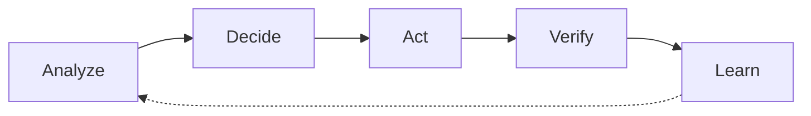

# Article Body: What to Share (Screenshots, Backend, Diagram)

**Purpose:** Use the Body editor tools (Image, Code, Table, Link, etc.) to showcase the app in line with [HACKATHON_COMPETITION_INFO.md](../HACKATHON_COMPETITION_INFO.md).  
**Body tools:** Paragraph/headings, **Bold**/Italic, **Code**, **Link**, **Image**, **Table**, lists, blockquote, divider.

---

## What the competition expects (from HACKATHON_COMPETITION_INFO)

| Article must include | How we cover it in Body |
|----------------------|-------------------------|
| **Overview of your application and why it matters** | My vision + Why this matters (text). Screenshots help “overview”. |
| **What AWS services you used** | **Table** in “How I built this” (already in ARTICLE_DRAFT). |
| **Team name** | “Built with Kiro and AWS. CostGuard AI Team.” at the end. |
| **Demo of your app** (video, screenshots, or interactive link) | **Images** (and/or video) in the **Demo** section. |

**Judging:** Innovation, Efficiency, Practical impact.  
**Innovation Award (10 winners):** “Breakthrough technical implementation and creative problem-solving.”  
→ Use **screenshots** (and optional **diagram**) to show the app and the **5-phase autonomous loop** (technical differentiation).

---

## Body tools and where to use them

| Tool | Use for |
|------|--------|
| **Image** | Demo screenshots, optional architecture/flow diagram. |
| **Code** | One short backend snippet (optional), e.g. autonomous phase routing or env config. |
| **Table** | AWS services (already in draft). Can add a small “Demo flow” or “Phases” table if useful. |
| **Link** | Link to live demo (if you have a public URL), or to repo. |
| **Headings** | App category, My vision, Why this matters, How I built this, Demo, What I learned. |
| **Bold / lists** | Emphasis and structure in each section. |

---

## 1. Frontend screenshots to share (Demo section)

**Your 7 screenshots – order and captions:** See **[DEMO_SCREENSHOTS_AND_CAPTIONS.md](./DEMO_SCREENSHOTS_AND_CAPTIONS.md)** for exact order (1. Demo, 2. Cost current estimate, 3. Prevention, 4. Forecast, 5. Cost history, 6. AI/ML, 7. Multi-account), captions, intro/outro text, and cover image suggestion. Use the **Image** tool for each; paste the caption under each image. When you have the actual screenshots, pick the clearest ones and add a one-line caption under each.

**Screenshot order and captions:** [DEMO_SCREENSHOTS_AND_CAPTIONS.md](./DEMO_SCREENSHOTS_AND_CAPTIONS.md). Summary below.

| # | Screenshot | Why (aligned with competition) | Suggested caption |
|---|------------|--------------------------------|--------------------|
| 1 | **Dashboard / home** | Shows “app overview” and that the app exists. | *CostGuard AI dashboard: cost, forecast, prevention, advisor, and autonomous demo.* |
| 2 | **“Run autonomous optimization”** (button + before/after or in progress) | Shows the unique feature (Phase 6 Extension); supports “breakthrough technical implementation.” | *Run autonomous optimization: one click to start the 5-phase loop.* |
| 3 | **Phase progress** (Analyze → Decide → Act → Verify → Learn) and **cumulative savings** | Shows execution and practical impact (savings). | *Autonomous loop in action: current phase and cumulative savings (e.g. 5.26s run, projected 20–30% savings).* |
| 4 | **Cost** or **Forecast** or **Advisor** screen (pick one or two) | Shows breadth: near-real-time cost, AI forecasting, or Bedrock advisor. | *e.g. AI-powered cost forecast (Bedrock)* or *Cost advisor: ask questions in natural language.* |

*(Full order and captions: [DEMO_SCREENSHOTS_AND_CAPTIONS.md](./DEMO_SCREENSHOTS_AND_CAPTIONS.md).)*

**Video option:** One short video (<5 min) showing: click “Run autonomous optimization” → phases advancing → savings. You can embed (e.g. YouTube) and still add 1–2 screenshots as thumbnails or backup.

---

## 2. Backend (optional one snippet)

Use the **Code** tool for **one** short snippet so experts see “technical implementation” without clutter.

**Options (pick one):**

- **A. Autonomous loop phase routing** (shows 5-phase structure):

```python
# Autonomous handler: route by path (Phase 6 Extension)
if path.endswith('/demo/start'):
    return handle_demo_start(event)
elif path.endswith('/demo-status'):
    return handle_demo_status(event)
# ... schedule-analysis, action-history, approve-action, rollback
```

- **B. Simple “what the API returns”** (e.g. demo-status response shape):

```json
{
  "current_phase": "Act",
  "overall_progress_percent": 60,
  "cumulative_savings": 150.00,
  "phases": ["Analyze", "Decide", "Act", "Verify", "Learn"]
}
```

- **C. Skip backend code** and rely on the **AWS services table** + **diagram** (below) for technical depth.

**Where to put it:** In **“How I built this”**, right after the AWS services table (one small code block with a short sentence: e.g. “The autonomous API routes requests by path; demo-status returns current phase and savings.”).

---

## 3. Diagram or flow (meaningful for hackathon)

Judging and Innovation Award favor **“breakthrough technical implementation”**. A **single, clear diagram** helps.

**Best candidate: 5-phase autonomous loop (Phase 6 Extension)**

- Simple flow: **Analyze → Decide → Act → Verify → Learn** (and optionally “back to Analyze” for learning).
- Shows what makes CostGuard different and ties to Phase 6 Extension.

**Ways to get an image:**

1. **Draw it** in any tool (Figma, draw.io, PowerPoint, Mermaid live editor) and export as PNG:
   - Boxes: Analyze → Decide → Act → Verify → Learn (with short labels, e.g. “GPU schedule” under Analyze, “Safety check” under Decide, “Right-size / act” under Act, “Verify savings” under Verify, “Learn” under Learn).
2. **Mermaid (paste somewhere that renders, then screenshot):**



3. **High-level architecture:** If you prefer “3 stacks” over “5 phases”, take a **screenshot of the README** architecture diagram (the ASCII art in `README.md`) if it’s readable in your viewer, or recreate a simple 3-box diagram: Core (Phases 1–4) | Multi-account (Phase 5) | AI/ML + Autonomous (Phase 6 + Extension).

**Where to put it:** In **“How I built this”** (before or after the AWS services table), or at the start of **“Demo”** with the line: *“The autonomous optimization follows a 5-phase loop: Analyze → Decide → Act → Verify → Learn.”*

---

## 4. Where each asset goes in the Body

| Section | Text (from ARTICLE_DRAFT) | Add with Body tools |
|---------|---------------------------|----------------------|
| App category | Yes | — |
| My vision | Yes | Optional: 1 small screenshot (dashboard) if you want “overview” here. |
| Why this matters | Yes | — |
| How I built this | Yes + AWS table | **Image:** 5-phase loop (or 3-stack) diagram. **Code (optional):** one backend snippet. |
| **Demo** | Yes | **Image:** Screenshots #1–4 (or video + 1–2 images). Required. |
| What I learned | Yes | — |
| Team name | Yes | — |

---

## 5. Checklist before you publish

- [ ] **Demo:** At least 2–3 frontend screenshots (dashboard, Run autonomous optimization, phase progress/savings) or 1 short video + 1–2 screenshots.
- [ ] **Diagram:** One diagram (5-phase loop preferred) in “How I built this” or “Demo”.
- [ ] **Backend (optional):** One short code block in “How I built this” (phase routing or demo-status shape).
- [ ] **Cover image** (in Builder Center UI): e.g. best dashboard or “Run autonomous optimization” screenshot.
- [ ] **Tags:** `#aideas-2025`, `#commercial-solutions`, region.

---

**When you have frontend screenshots:** Share them (or list filenames and what each shows), and we can refine captions and order. The table in section 1 above is the recommended set for what to share to align with the hackathon organizer’s requirements and judging criteria.
