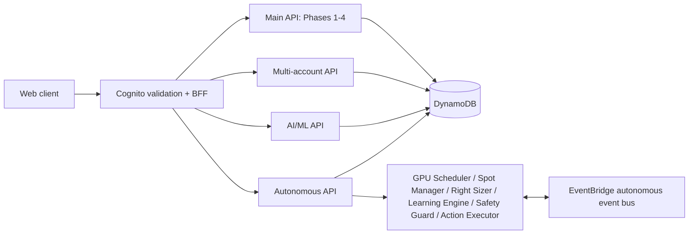

# Technical Architecture

**Source update:** October 14, 2026. Continuing implementations are unvalidated; all further testing is deferred. This page describes the checked-in backend. Deployment reports record earlier AWS runs; this review does not certify the live deployment or the separate frontend repository.

## Architecture Overview

The Python CDK application creates five stacks, each with its own responsibility. The frontend is maintained separately in `client-aws-ideas`.

| Stack | Scope | API base URL output |
|---|---|---|
| `CostGuardStack` | Phases 1-4; limited multi-account compatibility stubs | `APIEndpoint` |
| `CostGuardMultiAccountStack` | Organization discovery, costs, allocation and budgets | `MultiAccountAPIEndpoint` |
| `CostGuardAIMLStack` | GPU, SageMaker and Bedrock workload costs | `AIMLAPIEndpoint` |
| `CostGuardAutonomousStack` | Six worker Lambdas plus a separate nine-route API | `AutonomousAPIUrl` |
| `CostGuardBFFStack` | Cognito access-token validation and backend proxy | `BFFApiUrl` |

The dependency order is main -> multi-account -> AI/ML -> autonomous. The BFF has no CDK dependency on those stacks; its backend URLs and keys must be supplied through context or environment variables. The default region in the app is `us-east-1`.

Direct backend requests use their own API URLs and key requirements. With BFF, the browser sends a Cognito **access token** in `Authorization: Bearer ...`; `src/bff_handler.py` validates it through Cognito GetUser and adds the backend API key server-side. See [BFF deployment](../deployment/BFF_AUTH_DEPLOYMENT.md).

## Data Flow

### Historical Costs and Estimation

`POST /api/fetch` (also `/api/cost-data/fetch`) fetches Cost Explorer records and writes the main cost table. `GET /api/cost-data` reads stored records. Cost-estimation GET routes collect CloudWatch metrics and use service-specific pricing/estimation logic. These are estimates, rather than final AWS billing data.

### Forecasting

`GET /api/cost-forecast` and `/api/cost-forecast/service/{service}` check the forecast cache, retrieve **30 days** of stored history, and require at least **7 days**. All-zero history returns a zero forecast without invoking Bedrock. Otherwise the engine uses the Bedrock client, then caches the result. Horizons are 7, 14 or 30 days, with daily or weekly granularity. Model-provided bounds are requested at 95%; missing bounds fall back to +/-20%, which is not a statistical 95% confidence interval.

### Prevention and Advisor

The main Lambda handles scheduled budget monitoring and `/api/prevention/*` requests. Resource discovery and idle detection feed the safety and action services; dry-run mode, approvals and rollback support depend on action type. Discovery support does not imply every discovered resource can be modified or rolled back. Listings are bounded by operation and report coverage; scoped inventory persistence is separate from fresh observations. [Direct known-resource inspection](resource-inspection-contracts.md) adds metadata reads without listing/write/action side effects; [inventory contracts](inventory-persistence-contracts.md) describe identity namespaces and stored diagnostics.

`POST /api/advisor/query` uses the advisor engine, query processing, cost context, Bedrock and conversation/cache tables. History and suggestions have separate routes. Those tables, IAM permissions and routes are already defined in `cdk_stack.py`. [Current advisor evidence contracts](advisor-evidence-prompt-contracts.md) preserve questions/uncertainty, expose context omissions and original cached-answer provenance, and keep unavailable estimates/safety explicit.

### Multi-Account and AI/ML

The multi-account stack owns organization discovery, cross-account collection and 24 API methods across organization/cost/allocation/budget, report, forecast/advisor, policy configuration and Phase 7 measurement/analytics families. It does **not** use a `/api/multi-account` prefix. The main API exposes a few compatibility stubs; use the dedicated multi-account API for full behavior.

The AI/ML stack owns twenty API methods under `/api/ai-ml`. The main Lambda has delegation code, but the main CDK API does not define these routes. GPU observations require an operator-declared GPU-specific metric contract and complete hourly evidence; there is no CPU fallback or verified workload-identity/savings inference. Multi-account GPU cost/utilization routes reach their dedicated handlers; see [source synchronization](documentation-code-sync.md).

### Autonomous Actions

The autonomous stack has six worker Lambdas, a custom EventBridge bus, action/checkpoint/rollback tables, an S3 checkpoints bucket, SNS topics, and an API Lambda with **nine routes**. The workers run from schedules and events; the API can trigger analysis and an enabled demo.

`POST /api/autonomous/demo/start` requires `DEMO_MODE=true`, invokes GPU Scheduler asynchronously and writes a start record. Demo-status progress is time-based and combined with action-history data; it is not proof that every worker phase has completed. Approval and rollback APIs publish events from `costguard.autonomous.api`; an explicit rule routes approval/rejection and rollback requests to Safety Guard. Demo interruption events route to Spot Manager. Safety Guard emits execution requests after signed approval. The executor changes opted-in EC2 resources, records recovery state and emits completion events; rollback restores that state. Deployment execution defaults to disabled. Optional replacement training runs through a fixed SSM document and verifies model checkpoint progress. See [execution and recovery scope](autonomous-execution.md) and [EC2 training resume](ec2-training-resume.md). See [API contracts](api-design.md) and [autonomous endpoints](phase6-extension-endpoints-and-frontend.md).

New local feature contracts and access boundaries are described in [access and feature contracts](access-and-feature-contracts.md). Policies remain disabled configuration previews; commitment analytics are read-only. All new implementation validation is deferred.

## Persistence and Security

DynamoDB tables use on-demand billing and retain data on stack deletion. Several tables enable TTL; point-in-time recovery is enabled on the main historical cost table, while multi-account, AI/ML and autonomous table definitions disable it. See [database design](database-design.md) for exact keys and indexes.

Backend APIs use HTTPS. IAM roles grant service access to Lambda functions; Cognito/BFF provides user login. The multi-account handler additionally validates keys and rate limits using DynamoDB tables initialized by `setup_api_auth.py`. Backend endpoints are public API Gateway endpoints; the source does not define private APIs or a universal VPC boundary.

## Deployment and Validation

The deployment source of truth is [infrastructure/app.py](../../infrastructure/app.py), with the five stack modules beside it. Use stack-specific API outputs rather than assuming one URL handles every feature. [PROJECT_STATUS](../PROJECT_STATUS.md) distinguishes current source state from historical deployment/test results.

Cost and Free Tier figures in old reports are scenario estimates. CDK source alone does not establish present billing, current AWS eligibility, quotas, savings, or deployment health.

## Design Decisions

Lambda and API Gateway provide the request and event entry points. DynamoDB supports cost records, caches, configuration and audit data. Bedrock provides managed-model forecasting and advice. Separate stacks isolate the core, organization, AI/ML, autonomous and authentication responsibilities while sharing selected table names. The autonomous stack references the AI/ML GPU-cost table.

## Related Documentation

- [API design](api-design.md)
- [Database design](database-design.md)
- [Current backend review](phase6-and-extension-backend-review.md)
- [Deployment guidance](../deployment/README.md)
- [Historical project planning](../project/planning.md)

Current source review through task 215 links the focused GPU, Bedrock, SageMaker, inference/training, spot, workload declaration, audit and inventory contracts from the [sync summary](documentation-code-sync.md). All continuing validation remains deferred.

Autonomous action statistics now expose [bounded stored-outcome observations](autonomous-action-observation-contracts.md), unverified heuristic means and unavailable calibrated confidence. This read-only API/UI work does not certify or enable worker decision policies or resource execution. All validation remains deferred.
