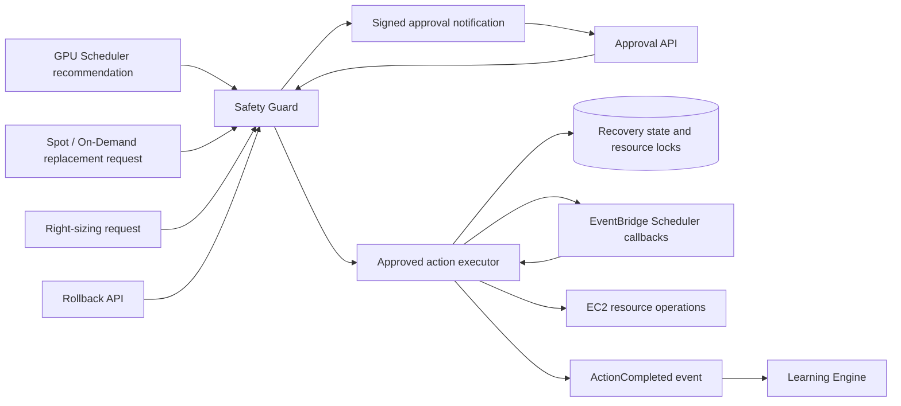

# Autonomous Execution and Rollback

**Source and mocked resource tests reviewed:** October 13, 2026. No deployment or live resource changes were performed.

## Supported Operations

The autonomous stack now defines six workers and one API Lambda. `autonomous.action_executor` owns resource changes; recommendation workers submit requests to Safety Guard.

| Action | Resource operation | Recovery operation |
|---|---|---|
| `schedule` | Create one-time start and stop callbacks for an existing stopped EC2 instance | Delete callbacks and restore its saved lifecycle state |
| `right_sizing` | Stop an existing EC2 instance, change its type, and restore its running/stopped state | Restore its saved type and lifecycle state |
| `spot_migration` | Provision one Spot instance from an explicitly versioned launch template | Terminate only the replacement owned by this action |
| `ondemand_fallback` | Provision one On-Demand instance from an explicitly versioned launch template | Terminate only the replacement owned by this action |

Replacement expiry also terminates the action-owned instance. Original instances, volumes and workloads are not migrated or terminated by this replacement path. Without a training contract, provisioning does not prove training resumed. With `parameters.training`, the executor runs the supported EC2 reference workload through SSM, restores model/optimizer state and verifies checkpoint progress. See [training resume](ec2-training-resume.md).

## Event Flow



API `ActionApproved`/`ActionRejected`/`RollbackRequested` events reach Safety Guard. Approved decisions emit `ExecuteAction`; accepted rollback requests emit `ExecuteRollback`. Both target the executor. Scheduler recommendations have their own Safety Guard rule; recommendations without a workload remain analysis only. Spot and right-sizing requests include the complete executable parameters and require approval.

## Workload Parameters

`POST /api/autonomous/schedule-analysis` accepts `days`, `confidence_threshold`, `dry_run` and an optional `workload` object. Direct Lambda input and API Gateway bodies use the same per-call parameters. Dry runs do not publish recommendations or record them as completed actions.

Example request, with a real instance ID substituted:

```json
{
  "days": 7,
  "confidence_threshold": 0.8,
  "dry_run": false,
  "workload": {"instance_id": "i-managed-training-instance", "max_hourly_cost": "0.526"}
}
```

The scheduler attaches the recommendation's future `window_start`, `window_end` and region to the workload. Safety Guard requires timezone-qualified start/end times, a future start and a window no longer than 24 hours. Starting the instance relies on its own configured workload startup behavior; this does not launch a SageMaker training job.

Replacement events supplied to Spot Manager require `instance_id`, `training_job_id` and `parameters`. Parameters require `region`, `launch_template_id`, a numeric `launch_template_version`, `max_runtime_minutes` (1-1440) and a positive `max_hourly_cost`. Optional `training_state` is checkpoint metadata supplied by the workload. Bare native interruption events have insufficient workload configuration and are rejected; an integration must supply this metadata. No replacement ID or approval is fabricated.

Right Sizer can submit requests when direct input includes `execute: true` and a positive `max_hourly_cost`. Requests also include `instance_id`, `new_instance_type` and region. Missing utilization data returns no production recommendation; demo metrics never authorize execution. Legacy direct migration/rollback helpers no longer claim simulated success.

## Approval, State and Recovery

Every supported resource operation requires a signed human approval. The request is stored before notification. Approval submission returns **202** with `status: "approval_submitted"`; the decision and execution are asynchronous. Approval signatures use a Secrets Manager key provisioned by CDK. Frontend clients should refresh action history after submission.

The approval deadline is `approval_expires_at`, separate from the 90-day `ttl` retention. Identical approval deliveries can retry execution-event publication without reversing the decision or resetting a completed/rolled-back action. A new execution cannot start after its approval deadline. Action history retains the original action/timestamp key throughout execution and learning.

Resource changes require `CostGuardManaged=true`; `CostGuardProtected=true`, `DoNotStop=true`, and production environment tags block them. Launch templates must be opted in and use an explicit numeric version. Training templates may use the exact configured SSM training instance-profile ARN. Other profiles and market overrides are rejected. Execution is restricted to the stack region. Actual pre-action state is stored in `costguard-migration-rollbacks` before any resource mutation. That table also stores resource locks to prevent overlapping actions on one existing instance.

The executor rechecks a Cost Explorer USD month-to-date baseline plus the operator-supplied cost estimate against its configured budget limit. It blocks execution when billing data is unavailable or the estimate exceeds the limit. Cost Explorer lag, estimate accuracy and delayed cleanup mean this is a budget check, not a guaranteed billing cap or Free Tier promise.

One-time stop/expiry timers are created before starts or replacement launches. Callbacks enforce their times. Action leases prevent concurrent deliveries; EC2 launches use a stable client token. Recovery handles partial resource changes, deletes schedules and restores saved EC2 state. A later resource change can block rollback rather than being overwritten. A replacement is terminated only when both its ownership tag and client token match the action.

Successful operation completion publishes `ActionCompleted` with the original action timestamp. Learning updates that record idempotently and does not resurrect a later rollback. Publication failures preserve resource state and can resend the event. Completion data does not invent measured cost or performance impact. Schedule completion follows the stop callback; resource-only replacement completion means provisioning. Training replacements complete only after successful command execution and verified model-state progress; this does not certify full model-training completion.

## Deployment Configuration and Failure Recovery

`EnableAutonomousExecution` defaults to `false` in CDK. The executor leaves approved records unexecuted while disabled. Deploying with that parameter explicitly set to `true` enables resource changes; this repository work did not deploy it. Previously submitted approvals can be resubmitted to retry execution after opt-in.

CDK provisions a Scheduler group and invocation role, an executor role/Lambda, an approval secret and a 14-day SQS dead-letter queue. Failed executor deliveries and schedule callbacks are retained there after retries. Callback delivery or permission failure requires inspection and recovery; timers are not a guarantee that cleanup has finished. Persistent resource locks after an execution failure should be resolved through the action's rollback rather than deleted blindly. IAM permissions cover the stack region, the schedule group, the invocation role and the existing action/recovery tables.

The existing nine-route API is unchanged in count. Rollback acceptance still returns 202; inspect history for `rolling_back`/`rolled_back` or an execution error. Old metadata-only rollback records are not executable recovery snapshots. The supported reference workload restores actual training state; live validation and adapters for other models/frameworks remain separate follow-up work.

## Verification and Sources

Regression tests use Moto EC2/DynamoDB resources, mocked billing/events/schedule clients and local CDK synthesis. They verify approval-to-execution routing, resource restoration, ownership, duplicate events, expired approvals, leases, resource conflicts, partial recovery, early callbacks, disabled execution and failure reporting. No AWS account was contacted and no frontend integration was reverified.

The API behavior follows the AWS [Scheduler target documentation](https://docs.aws.amazon.com/scheduler/latest/UserGuide/managing-targets.html), [RunInstances API](https://docs.aws.amazon.com/AWSEC2/latest/APIReference/API_RunInstances.html) and [EC2 idempotency reference](https://docs.aws.amazon.com/ec2/latest/devguide/ec2-api-idempotency.html).

See [source synchronization](documentation-code-sync.md), [API contracts](api-design.md) and [database schema](database-design.md).
